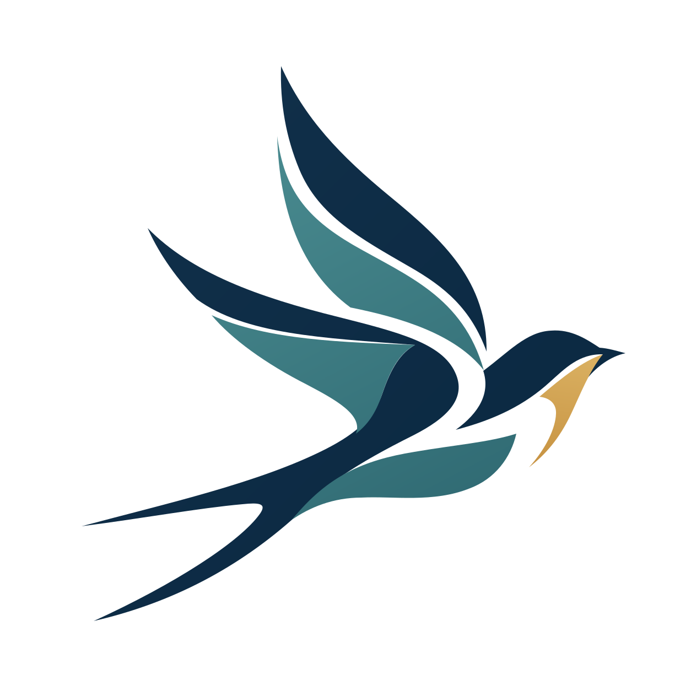

<!-- rumdl-disable MD041 -->

  
  <h1>Movara</h1>
  
<strong>面向自主式交通系统多主体交互的交通仿真平台</strong>

  
A Multi-Agent Interaction Simulator for Autonomous Transportation Systems

  

    
    
    
  

  

    <a href="docs/requirements.md">平台需求</a> ·
    <a href="docs/design/core.md">核心设计</a> ·
    <a href="docs/python-api/README.md">Python API</a> ·
    <a href="docs/development.md">开发指南</a> ·
    <a href="docs/ROADMAP.md">路线图</a>
  

---

> [!IMPORTANT]
> Movara 当前处于早期开发阶段，正在完善设计与工程基础。功能、接口和数据格式可能发生较大调整。

## 项目目标

Movara 面向自主式交通系统研究，旨在提供独立仿真内核、原生桌面界面和 Python 接口，支持机动车、非机动车与行人的多主体交互、协同决策和交通管理实验。

世界以对象的位置、姿态、运动和轮廓为基础。道路与车道提供导航和交通规则语义，主体通过可组合的感知、通信、记忆和行为策略参与仿真。

设计范围涵盖正常交通、违规行为、事故处置与恢复。场景、动作、状态和事件记录为重复实验与结果分析提供依据。

## 项目文档

| 文档 | 内容 |
| --- | --- |
| [平台需求](docs/requirements.md) | 使用场景、目标能力和范围边界 |
| [核心设计](docs/design/core.md) | 系统结构、世界模型、运动、信息与程序接口 |
| [路网与空间](docs/design/network.md) | 承载表面、通行连接、交通规则、两类规划与 Waypoint |
| [主体设计](docs/design/agents.md) | 实体与 Agent、主体操作、道路关系及查询 |
| [运动模型](docs/design/motion.md) | 运动学模型、控制约束、数值推进与接触停驶 |
| [执行与记录](docs/design/execution.md) | 逻辑时间、共享控制、命令解析、录制与回放 |
| [桌面界面](docs/design/gui.md) | 交互、显示、信息检查与后续输出 |
| [Python API](docs/python-api/README.md) | 实例连接、控制回合、查询订阅、定时命令与事件回调 |
| [开发指南](docs/development.md) | 技术选型、计算后端、工程质量与文档维护 |
| [行为模型](docs/design/models.md) | 数据、交互样本、模型接入与评价 |
| [技术原型方案](docs/design/prototype.md) | 原型场景、首轮策略、代码分工与验收范围 |
| [技术验证计划](docs/design/validation.md) | 最小样例、预期结果、采用条件与验证顺序 |
| [同类工具对比](docs/comparisons.md) | 定位、能力维度与比较条件 |
| [路线图](docs/ROADMAP.md) | 阶段目标、交付范围与验收要求 |
| [工程筹备计划](docs/TODO.md) | 当前议题与筹备进度 |

## 许可证

Movara 采用 [Apache License 2.0](LICENSE) 许可证。
