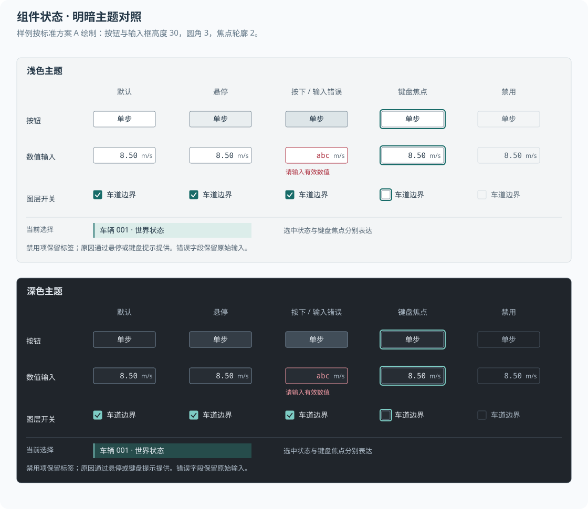

# 组件与操作规则

本文定义基础工作区使用的组件行为。视觉尺寸与颜色引用[设计参数](tokens.md)，运行操作遵循[工作区与交互](workspace.md)。规则用于约束原型与后续实现，实际交付按对应功能阶段安排。

## 操作入口

样例使用标准方案 A 的候选尺寸，文字与控件引用设计参数中的角色。图示表达静态外观，提示、键盘与输入行为通过交互原型评价。

常用运行操作直接显示在工具栏：运行或暂停、单步及当前 Tick 与逻辑时间。加载、重置与结束运行保留明确入口，并按作用分组。表示不同生命周期行为的按钮采用各自名称。

| 组件 | 表达与布局 | 交互规则 |
| --- | --- | --- |
| 文字按钮 | 文字与可选图标作为整体居中 | 提供悬停、按下、键盘焦点及禁用状态 |
| 工具按钮 | 16 逻辑像素图标，使用完整按钮命中区域 | 提供可访问名称、操作名称及适用快捷键提示 |
| 切换按钮 | 通过选中底色或标记表示持续状态 | 单次点击切换，焦点轮廓独立于选中状态 |
| 菜单项 | 名称、可选图标、快捷键按列对齐 | 禁用项保留原因提示，所有入口共享同一可用条件 |
| 主操作 | 在当前作用区域使用必要的强调 | 常规检查和视图操作采用弱化样式 |
| 危险操作 | 明确对象、作用范围及后果 | 按实际破坏性决定是否确认，执行反馈保留可检查入口 |

按钮图标、文字和快捷键按相应基线对齐。图标按钮的提示在键盘聚焦时同样可获得。禁用控件保持可辨识的标签，通过原因提示说明前置条件。

## 参数与数值编辑

属性编辑采用“标签、值、单位”的稳定列结构。数值右对齐，文本左对齐；单位占独立列。只读值与可编辑输入通过样式及交互状态区分。

| 情况 | 处理规则 |
| --- | --- |
| 开始编辑 | 保留原始值和目标身份，明确当前编辑字段 |
| 输入中 | 在本地维护草稿，按单位及字段类型解析 |
| Enter | 中文组合输入完成后，校验并提交当前编辑范围 |
| Escape | 先服从输入法组合状态，再取消未提交编辑并恢复原值 |
| 校验失败 | 保留输入，在字段附近显示具体原因 |
| 失去焦点 | 合法的单字段值按编辑约定提交；非法输入保持草稿与错误提示 |
| 关联多字段 | 采用明确的应用和取消操作，原子提交相互关联的数据 |
| 已接收 | 显示请求已接收及必要的等待状态 |
| 已生效 | 根据确认结果更新实际值、来源和生效版本 |

直接拖动数值、滚轮修改和连续提交需要单独的适用规则。基础数值输入优先采用键盘编辑，避免画布滚动意外修改参数。

## 对象、属性与事件

对象列表选择整行，选中样式使用语义 Token。对象身份、名称和类别分别保留，截断文字提供完整查看与复制入口。列表更新保持选择、滚动位置和明确的排序规则。

图层开关只改变显示；行选择用于检查该图层或对象。开关操作与行选择分别命中，控件状态和键盘行为保持一致。

属性面板顶部显示当前对象身份，按主题组织几何、运动、策略与来源。空选择显示检查指引，多选按已支持的共同能力提供结果。暂不支持的批量编辑需要明确说明。

事件列表表达事件时刻、类型、相关对象及摘要。点击记录显示详细内容或定位对象，跳转历史时刻按回放能力提供。实时跟随日志使用显式开关，手动滚动后保持用户阅读位置。

## 面板、对话框与通知

分割线支持拖动、明确的悬停反馈和键盘调整入口；面板最小尺寸由布局参数约束。折叠与恢复保留原有尺寸，恢复默认布局作为独立操作。

对话框标题说明任务，正文给出操作对象和作用范围。焦点进入对话框后保持可预测的遍历顺序，关闭后返回发起操作的位置。错误修正优先保留上下文。

成功通知采用短暂反馈，故障、等待原因和需要处理的警告保留持续入口。通知显示不抢占正在输入或观察的焦点。

## 命令面板候选

命令面板用于检索已存在的操作，首轮是否实现按原型范围确定。所有纳入面板的操作继续保留菜单或直接入口，运行、暂停和单步始终在工具栏可见。

| 项目 | 候选规则 |
| --- | --- |
| 打开入口 | 菜单“命令面板…”；快捷键候选 `Ctrl+Shift+P` |
| 检索范围 | 加载、运行、视图、图层、检查和导出等已实现操作 |
| 搜索匹配 | 中文名称、英文别名及明确维护的关键词 |
| 结果布局 | 左侧操作名称，补充所属区域或作用对象，右侧快捷键 |
| 可用性 | 依据当前状态和选择对象更新；禁用操作展示原因 |
| 键盘 | 上下键选择，Enter 执行，Escape 关闭；组合输入优先由输入法处理 |
| 执行 | 调用与菜单及工具栏相同的命令入口，危险操作保留确认规则 |
| 焦点恢复 | 关闭或执行后按操作上下文恢复焦点 |
| 尺寸 | 宽度候选 560，备选 640；两侧至少保留 24，列表最多显示 10 项后滚动 |

命令检索与对象检索按不同任务表达，首轮可分别提供。命令面板不解释脚本、表达式或自然语言指令。

## 首轮组件评价

组件展示与工作区原型复用同一实现和参数。每类交互至少检查鼠标、键盘、禁用、中文输入及错误反馈，并在两套候选密度与明暗主题下比较。

默认值、悬停反馈及焦点规则集中维护。组件的特殊变体需要说明实际使用场景，并在组件展示中保留对应样例。
