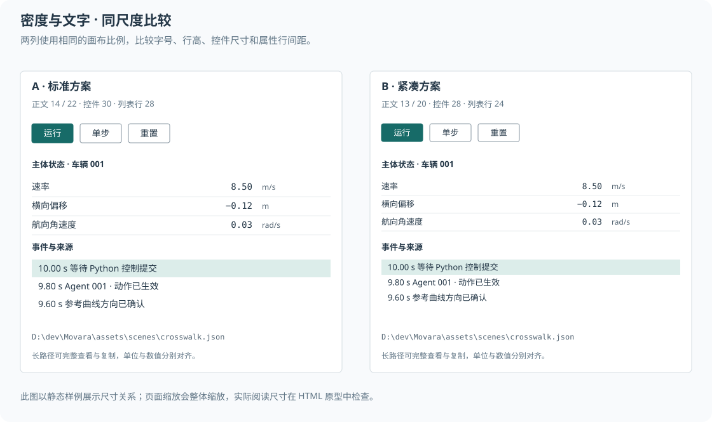
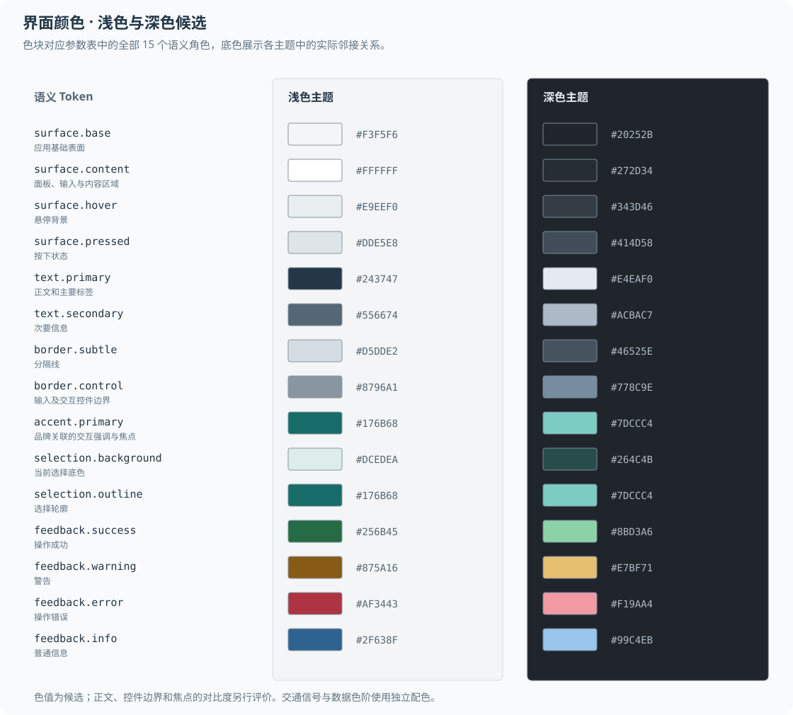

# 设计参数

本文定义界面原型采用的候选 Design Tokens。参数以逻辑像素表示，原生界面对应设备无关尺寸，HTML 原型使用 CSS 像素。系统缩放与设备像素转换在平台层处理。

## 参数采用与调整

候选参数用于构建可比较的完整方案。工作区默认以标准方案 A 评价，紧凑方案 B 用于比较高密度任务。字号、行高、控件高度与内边距按同一方案成组切换。

页面与组件通过语义 Token 引用参数。局部实现不得任意新增相近的颜色、字号或间距值。特殊需求应先检查现有角色，必要时增加有明确用途的组件 Token。

参数调整同时更新定义、使用组件和相关原型。调整记录保存在本地，说明修改原因、影响范围与比较结果；采用后的数值写入本表。系统窗口控件等平台尺寸按相应平台规则处理。

## 尺寸与密度候选

图中两套方案使用同一绘制比例。文档预览会整体缩放 SVG，实际阅读尺寸在 HTML 原型中检查。

| 角色 | 标准方案 A | 紧凑方案 B | 使用条件 |
| --- | --- | --- | --- |
| 正文字号 / 行高 | 14 / 22 | 13 / 20 | 属性、列表与说明正文 |
| 次要文字字号 / 行高 | 12 / 18 | 12 / 18 | 时间、来源与补充说明；关键信息沿用正文 |
| 面板标题字号 / 行高 | 13 / 20 | 13 / 20 | 采用中等字重，通过位置与分隔建立层级 |
| 对话框标题字号 / 行高 | 16 / 24 | 16 / 24 | 短标题，保持主题切换后的层级 |
| 按钮与输入框高度 | 30 | 28 | 工具栏与常规表单 |
| 小型工具按钮高度 | 26 | 24 | 面板局部操作，命中区域覆盖整个按钮 |
| 列表与表格行高 | 28 | 24 | 单行内容；多行内容按正文行高扩展 |
| 属性行最小高度 | 30 | 28 | 编辑状态适应输入控件 |
| 图标尺寸 | 16 | 16 | 统一线条风格，图标和文字共同对齐 |
| 常规水平内边距 | 10 | 8 | 按钮与输入框，两端对称 |
| 面板内容内边距 | 12 | 8 | 表格和画布可以贴合所属区域边界 |
| 分组间距 | 12 | 8 | 同一主题内的内容分组 |

文字缩放后允许控件增长，需保持内容完整与命中范围。密度切换保持文字含义、操作可用性和焦点顺序一致。

### 间距、边界与圆角

| 角色 | 候选值 | 规则 |
| --- | --- | --- |
| 间距刻度 | 2、4、8、12、16、24 | 2 用于细微对齐，4/8 用于控件组合，16/24 用于较大内容分组 |
| 普通分隔线 | 1 | 面板、表格和菜单边界 |
| 焦点轮廓 | 2 | 与选中底色分别表达 |
| 工作区分割线 | 1；命中宽度 6 | 可见线与拖动命中范围分别定义 |
| 画布、停靠面板、表格圆角 | 0 | 持续占据工作区的区域使用平直边界 |
| 按钮、输入框圆角 | 3；备选 4 | 同一参数方案采用统一值 |
| 菜单、对话框圆角 | 6；备选 8 | 表达独立浮层，取值在全局统一 |
| 状态标签圆角 | 2 | 紧凑文字标签，颜色辅以状态词 |
| 普通控件阴影 | 无 | 通过边界、底色与状态区分 |
| 浮层阴影 | 小范围弱阴影 | 候选为偏移 0/4、模糊 12、黑色透明度 12%，暗色主题另行比较 |
| 状态过渡 | 80–120 ms | 仅用于悬停、按下和焦点等短反馈；减少动态效果时关闭 |

窗口外框圆角属于平台外观。原型中的窗口示意与正文 SVG 图示各自按用途绘制，二者不决定应用组件圆角。

## 颜色候选

下表为同一套语义角色的浅色和深色候选值。对比度与图层叠加需要在原型中测量，采用前检查正文、弱化信息、焦点和交互边界。

| Token | 浅色候选 | 深色候选 | 用途 |
| --- | --- | --- | --- |
| `surface.base` | `#F3F5F6` | `#20252B` | 应用基础表面 |
| `surface.content` | `#FFFFFF` | `#272D34` | 面板、输入与内容区域 |
| `surface.hover` | `#E9EEF0` | `#343D46` | 悬停背景 |
| `surface.pressed` | `#DDE5E8` | `#414D58` | 按下状态 |
| `text.primary` | `#243747` | `#E4EAF0` | 正文和主要标签 |
| `text.secondary` | `#556674` | `#ACBAC7` | 次要信息 |
| `border.subtle` | `#D5DDE2` | `#46525E` | 分隔线 |
| `border.control` | `#8796A1` | `#778C9E` | 输入及交互控件边界 |
| `accent.primary` | `#176B68` | `#7DCCC4` | 品牌关联的交互强调与焦点 |
| `selection.background` | `#DCEDEA` | `#264C4B` | 当前选择底色 |
| `selection.outline` | `#176B68` | `#7DCCC4` | 选择轮廓 |
| `feedback.success` | `#256B45` | `#8BD3A6` | 操作成功 |
| `feedback.warning` | `#875A16` | `#E7BF71` | 警告 |
| `feedback.error` | `#AF3443` | `#F19AA4` | 操作错误 |
| `feedback.info` | `#2F638F` | `#99C4EB` | 普通信息 |

运行状态按语义角色映射：运行使用成功色，人工暂停使用次要文字，等待控制使用警告色，故障使用错误色，正常结束使用信息色。状态词始终显示。

交通信号、主体类别、速度色阶及图表系列维护独立的数据配色。界面主题切换时同步检查数据颜色，具体数值按画布样例评价。界面选择使用轮廓或外环，保留信号灯等具有固定意义的原始颜色。

## 字体与数值

Windows 候选字体栈采用 `Segoe UI`、`Microsoft YaHei UI`、`Microsoft YaHei` 和系统无衬线字体，检查中文回退后的基线与字重。Linux 候选采用 `Noto Sans` 与 `Noto Sans CJK SC`，实际采用需验证目标平台的可用性。

代码和路径可以采用系统等宽字体及明确的中文回退。普通界面标签使用正文文字角色。表格数值采用等宽数字能力，字段的单位与显示精度由数据语义确定。

字号候选先覆盖中文长术语、带单位小数、负数、英文标识和路径。参数比较同时检查 100%、125%、150% 与 200% 系统缩放；原型的浏览器缩放另行记录。
