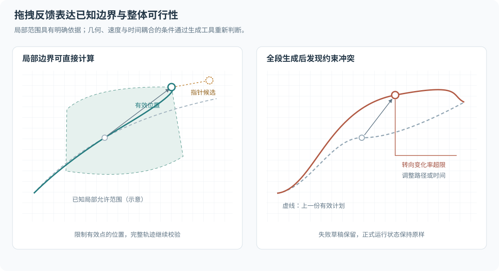

# 轨迹编辑交互

轨迹编辑把空间通过点、速度或时间条件组织为可预览的干预计划。领域数据、约束与提交语义见[轨迹编制与执行](../../../docs/design/agents/trajectory.md)。本章定义手动编制的界面候选，具体算法和交互延迟通过原型评价确定。

## 进入与提交

用户选择主体，在暂停状态进入轨迹编辑。起点关联当前实际状态与版本，并显示其速度、朝向和模型能力。编辑工具保存独立草稿，世界状态保持原有值。

界面提供路径与速度条件、指定到达时间、导入轨迹三种入口。首轮默认采用路径与速度条件。用户在曲线上新增通过点，拖动位置，并在属性区编辑速度或时间要求。起点作为当前状态锚点固定，显式修改实体状态属于独立操作。

候选路径、生成的时间轨迹与主体实际状态分别显示。用户通过预览检查时标、速度、约束与预测风险，确认后提交完整轨迹。实际接收与生效边界沿用应用命令反馈。编辑取消时丢弃本次草稿；已生效的轨迹通过明确的取消接管操作结束。

## 拖拽与可行性反馈

编辑点默认是曲线上的通过点。插入时根据指针到当前曲线的投影确定位置，拖动后重新生成受影响的候选区段。车辆航向、曲率、速度和到达时间之间存在耦合，生成工具按实际支持范围提供诊断。

| 情况 | 拖拽表现 | 松开后的处理 |
| --- | --- | --- |
| 当前状态锚点 | 固定点具有锁定标识 | 通过独立的状态编辑操作改变起始条件 |
| 可稳定计算的局部硬边界 | 显示允许范围、指针候选与有效位置，可限制有效点或吸附到边界 | 采用清楚显示的有效位置，再完成全段校验 |
| 需要全段计算的约束 | 点随指针形成草稿，显示候选曲线与上一份有效计划 | 完成生成后确认可行性，失败草稿保留原因与修订入口 |
| 交通规则或舒适性偏好 | 保留拖动位置，显示警告、受影响区段和对应规则 | 调用方按规划配置决定保留或修订 |
| 接触或占用风险 | 显示相关对象、轮廓范围和预测时段 | 作为明确的实验风险确认，实际接触按内核处理 |

固定圆形拖拽范围只用于有明确几何依据的局部限制。涉及多个点、速度与时间的条件通过重新生成判断。局部拖拽通过之后，完整轨迹仍需提交前校验。

取消本次拖动恢复拖动前的点位。自动回弹仅用于明确取消或被局部规则拒绝的拖动，并显示对应原因。全段校验失败时保留可编辑草稿，上一份有效计划继续作为参考，正式运行状态保持原样。

## 状态与样式

| 状态 | 视觉表达 | 操作 |
| --- | --- | --- |
| 选中编辑点 | 明确轮廓、点序号与键盘焦点 | 拖动、数值编辑或删除允许移除的点 |
| 正在生成 | 稳定的局部状态标识与候选曲线 | 继续编辑或取消，提交暂不可用 |
| 硬约束失败 | 错误色、具体区段及原因 | 修订草稿或恢复上次有效方案 |
| 软约束警告 | 警告色与规则说明 | 查看依据、修订或按允许配置保留 |
| 可提交候选 | 正常计划样式及已完成检查范围 | 预览并确认提交 |
| 实际执行 | 参考与实际轨迹分层，显示偏差与状态版本 | 检查反馈、替换计划或结束接管 |

颜色结合线型、图标与文字表达状态。错误和警告保留到对象或区段附近，并在属性区提供详细信息。时间文字沿用独立显示开关，采样点表达等时间间隔。

拖拽中的高频反馈采用局部样式与属性更新，校验可合并到最近的草稿版本。过期生成结果按版本丢弃。界面不为每次越界弹出通知，主要工作区保持稳定。覆盖层、通知和对话框沿用[组件规则](components.md#面板对话框与通知)。

## 修订、记录与实施范围

界面可提供延长到达时间、降低目标速度、调整通过点等显式修订动作。用户先查看变化，再决定采用。起始状态、输入条件、原始草稿、实际生成轨迹、约束配置与采用的修订结果分别保留。

首轮原型评价关键点增删与拖动、速度条件、自动时间生成、局部约束提示、全段失败反馈及提交取消流程。自由曲线手柄、复杂自动避障和通用轨迹优化器按实际任务另行确定。

交互实现分为局部指针反馈、草稿生成和领域校验。生成算法可以独立于 UI 测试；GUI 与 Python 复用领域结果。交互预览与真实运动的验证分别安排。
