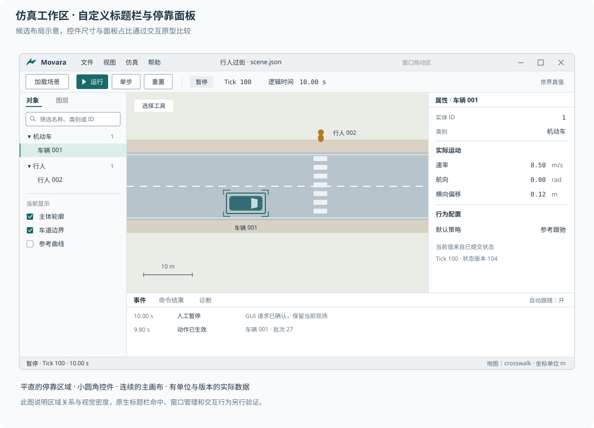

# 工作区与交互

Movara 工作区围绕场景观察、运行控制和对象检查组织。界面显示、主体策略和仿真执行分别维护自己的状态，运行语义遵循[桌面界面设计](../../../docs/design/gui.md)。

## 工作区组成

| 区域 | 主要内容 | 交互关系 |
| --- | --- | --- |
| 应用与运行工具 | 场景身份、加载、运行、暂停、单步与重置 | 显示当前状态及操作确认 |
| 主画布 | 地表、交通组织、主体、轨迹与空间事件 | 支持平移、缩放、选择及定位 |
| 对象与图层 | 对象筛选、分类、显示开关与图层说明 | 与画布选择和属性检查关联 |
| 属性检查 | 选中对象的身份、实际状态、配置及允许操作 | 明确对象范围、单位和数据版本 |
| 事件与诊断 | 领域事件、命令结果、控制等待和故障原因 | 根据记录定位对象及相应时刻 |
| 状态区域 | Tick、逻辑秒数、运行阶段和必要的显示信息 | 保持位置稳定，支持持续观察 |

主画布获得连续的主要空间，辅助面板按任务调整、折叠或恢复。布局提供明确的恢复入口，恢复内容包含面板尺寸、可见性和视图偏好。

工作区布局属于应用本地状态。仿真恢复使用场景、运行记录或检查点的领域操作。布局恢复不会自动推进或恢复运行。

## 标题栏与布局参数

应用采用自定义标题栏，统一窗口标识、场景上下文、菜单及窗口控制的视觉层级。标题栏提供稳定的拖动区域，运行工具栏单独组织高频操作。

### 标题栏交互

左侧保留应用标识与菜单入口，场景标题按整个标题栏居中，右侧保留最小化、最大化或还原及关闭控制。场景标题可以截断，窗口控制保持完整可用。

空白及非交互标题区域支持拖动、双击最大化或还原，以及系统窗口菜单。按钮、菜单和输入区域明确排除拖动命中。窗口边缘缩放和平台窗口管理行为随原生实现验收，Windows 包括贴靠布局等适用行为。

标题栏表达窗口激活与未激活状态，数据画布保持自己的显示语义。系统窗口按钮的布局、命中与可访问性按平台规则处理。自定义绘制与系统管理功能分别验证。

关闭窗口沿用退出应用的生命周期语义，其他客户端接收相应通知。标题栏中的关闭操作与结束当前仿真分别表达。

### 初始尺寸候选

下表采用与[设计参数](tokens.md)一致的逻辑像素。候选尺寸用于比较，最小尺寸由内容与布局约束共同决定。

| 区域 | 基准候选 | 比较候选或调整范围 |
| --- | --- | --- |
| 自定义标题栏高度 | 36 | 比较 40；文字缩放时适应内容 |
| 运行工具栏高度 | 40 | 紧凑方案比较 36 |
| 停靠面板标题高度 | 28 | 紧凑方案比较 26 |
| 底部状态栏高度 | 24 | 随文字缩放适应内容 |
| 左侧对象与图层宽度 | 220 | 180–320 |
| 右侧属性宽度 | 300 | 260–420 |
| 底部事件区域高度 | 180 | 120–320，可折叠 |
| 主画布目标最小宽度 | 560 | 空间不足时收起辅助区域 |
| 主画布目标最小高度 | 360 | 空间不足时优先折叠底部区域 |

主画布最小尺寸是布局评价目标。窄窗口先折叠底部事件区和左侧辅助区，再将属性区切换为临时面板；必要工具进入明确的溢出菜单。具体断点根据原型中实际内容占用确定。

在 1440×900 与 1600×1000 逻辑尺寸比较默认布局，并检查较小窗口。缩小窗口保留运行状态、窗口控制和主要运行入口，场景标题及低频工具按顺序让出空间。

## 选择、图层与属性

对象列表与画布共享明确的选择上下文，属性面板显示当前选择的对象身份。选择对象、定位到对象和持续跟随对象分别提供清楚的操作反馈。

图层描述显示内容，例如主体轮廓、车道边界、参考曲线和轨迹。关闭图层只改变显示，主体仍按原有规则参与仿真。道路、通行区域和主体具有各自的查询语义，画布拾取按对象类型提供检查内容。

工作区候选布局将视图图层固定在左侧辅助区底部，对象列表在上方独立滚动。参考路线与空间网格等观察开关在图层区直接提供；主题、密度等全局外观选项归入设置。原型顶部的主题与密度控件用于设计比较。

图层开关采用具有文字标签与持续选中状态的 Toggle Button。悬停、选中和键盘焦点分别表达，选中状态通过底色与边界共同呈现。

图层区依据自身可用宽度在一列与两列间自适应排列，顺序保持一致。面板显示与隐藏沿用明确的画布、侧栏和记录区位置，画布占据释放后的空间。

参考路线与轨迹按主体类别配色，全部主体淡显，当前选中主体高亮。细虚线表示参考路线，低透明度短虚线表示历史轨迹，实线与等时间间隔采样点表示未来轨迹。线型与透明度共同区分内容，主体颜色保持稳定。三类内容分别提供图层开关。

选中未来轨迹的采样点表达时间间隔，点间距离表达运动快慢。相对当前观察时刻的时间文字通过独立开关显示，默认隐藏。未来轨迹隐藏时，时间文字开关暂不可用并保留原有选择。参考路线仅描述空间几何，时间标记依据实际提供的轨迹或预测数据生成。

## 历史与时间控制

当前运行的历史与录制文件共用历史记录界面。当前运行的历史范围随记录增长，并提供“返回实时”操作。历史浏览保持当前运行的数据完整，画布和属性按同一历史时刻展示，并持续标记所查看的时间与运行身份。

时间控制条悬浮在画布底部，使用半透明表面、背景模糊、细边框与克制阴影。展开状态提供播放、时间拖动、事件跳转和时间读数；收起状态保留小型浮动入口。控件覆盖画布，主工作区的纵向布局保持稳定。实时视图默认收起，打开录制时默认展开，用户可以手动调整。

画布浮动工具共用表面、边界、阴影与焦点规范。收起入口采用角落图标按钮，名称通过 tooltip 与无障碍标签提供。比例尺与历史入口相邻，固定在画布角落；比例尺长度随当前视图缩放更新，时间控件展开时保留比例尺位置。

“从此处创建实验”从选定历史时刻建立新运行。界面明确显示来源、时刻与新实验名称，原运行及后续记录保留。实验对比按共同仿真时间对齐，干预时刻显式标记；并排画布与指标对照按功能阶段提供。

历史浏览与实验恢复使用统一运行记录。完整恢复要求及外部策略状态的边界见[回放与实验分支](../../../docs/design/execution.md#回放与实验分支)。

## 属性与信息来源

世界真值与 Agent 可用信息采用明确的视图标识。主体观测视图表达信息来源、采样时刻、历史估计和未知内容。视图切换保持内核的信息权限。

属性标签、数值与单位按列对齐，实际值和目标值分别表达。允许编辑的字段提供取值条件、提交入口及验证反馈。操作提交后显示接收状态，实际生效后显示确认结果和必要的 Tick 或版本。

多个客户端修改同一字段时，界面沿用统一命令规则展示最终结果及来源。当前选择和未提交输入在界面本地维护，提交时校验目标身份与版本。

## 主体与信号控制

主体检查按状态、行为配置、导航与外部动作组织。目的地表达任务目标，参考路线表达规划建议，带时间轨迹表达期望运动。具体参数按所选模型与主体能力展示。

| 控制内容 | 界面方式 |
| --- | --- |
| 行为模型 | 下拉选择已注册模型，展示适用主体、参数与切换反馈 |
| 模型参数 | 按模型提供目标速率、跟驰时距、过街间隙等有单位和范围的字段 |
| 目标与路线 | 地图点选目的地或目标区域，配置参考路线与途经点 |
| 临时控制 | 设置控制动作、持续时间及结束方式，显示当前接管来源 |
| 带时间轨迹 | 导入采样轨迹，或编辑关键点与时间／速度条件，预览后提交 |
| 主体能力 | 在场景配置中维护尺寸、运动限制与决策条件，运行操作按领域接口校验 |

轨迹编辑优先评价关键点增删、拖动、时间设置与预览。空间曲线与时间参数分别维护，提交前检查连续性、运动限制及执行范围。拖拽、局部硬边界与全段校验反馈见[轨迹编辑交互](trajectory-editor.md)，领域约定见[轨迹编制与执行](../../../docs/design/agents/trajectory.md)。

信号控制器可从设施列表或画布选择，右侧展示控制对象、当前相位与配时方案。绿灯时长、黄灯与全红间隔等关联字段成组校验和应用。当前灯色与方案参数分别表达，具体相位衔接、生效时刻和运行中修改规则沿用后续信号控制设计。

## 运行状态与反馈

| 情况 | 界面表达 | 主要交互 |
| --- | --- | --- |
| 尚未加载场景 | 明确的空状态与加载入口 | 选择场景或地图资源 |
| 正常运行 | 持续更新 Tick、秒数与运行状态 | 暂停、查询及有效的干预操作 |
| 人工暂停 | 保留现场与当前逻辑时间 | 单步、编辑或恢复运行 |
| 等待控制提交 | 显示等待阶段、控制来源及必要诊断 | 检查现场、提交有效请求或终止 |
| 故障停止 | 持续展示原因及未完成操作 | 检查记录，按生命周期规则处理 |
| 运行结束 | 保留最终状态和结束原因 | 查看结果、重置或加载场景 |

等待控制提交是运行中的调度阶段。它与人工暂停分别表达，底层状态与阶段字段沿用领域接口。

运行控制采用直接、稳定的入口。暂停、终止运行、重置和退出应用使用各自准确的名称与作用说明。操作可用性由运行状态及前置条件决定，禁用状态提供原因。

逻辑步长、仿真逻辑时间和墙钟推进速度分别显示。有限时长任务可以表达目标进度，持续运行显示已运行时间。推进速度调整的范围按应用能力声明。

故障信息保留可检查入口，并包含对象、操作和原因。短暂成功提示可以自动消失，需要处理的故障持续可见。刷新数据保持列表顺序、滚动位置和选择稳定，自动跟随日志提供明确开关。

状态反馈使用固定宽度的工具栏状态位置与覆盖式通知，主要分区保持稳定。短暂控制等待保持正常运行表达，达到界面提示阈值后显示等待原因；重复等待通知按运行与来源合并。故障保留检查能力，阻断任务以半透明覆盖层直接显示文字，需要用户选择时使用居中对话框。覆盖范围限定在标题栏下方的应用内容区。反馈规则见[面板、对话框与通知](components.md#面板对话框与通知)。

## 命令、焦点与编辑

菜单、工具栏、快捷键和命令搜索复用同一操作定义，采用一致的名称、可用条件和执行结果。命令搜索补充直接入口，高频运行控制在工作区可见。命令面板候选与组件规则见[组件与操作规则](components.md)。

全局命令与画布、表格、输入框的局部命令分别处理。焦点具有可辨识的视觉状态，按键只作用于明确的操作上下文。文字输入与中文组合输入期间，编辑按键优先由输入控件处理。

画布中的平移、选择和编辑工具保持可识别的当前模式。需要确认的交互提供完成和取消入口；离开工具时明确处理未提交修改。具体快捷键与鼠标组合在原型评价后固定。

场景配置编辑可以按已实现的编辑能力提供撤销与重做。运行期间的世界修改、恢复和重跑沿用仿真命令及记录语义，界面明确显示相应作用范围。

## 图形化配置与节点视图

图形界面可以采用以下形式，各自按任务需要提供：

| 形式 | 作用 | 数据依据 |
| --- | --- | --- |
| 关系图 | 展示通行连接、对象关联或策略状态 | 已有领域数据与只读查询 |
| 结构化配置编辑 | 修改已有参数、时序或有限配置 | 已定义的配置结构和校验规则 |
| 可执行节点程序 | 组合自定义条件、数据流和控制逻辑 | 需要独立定义的语言与执行语义 |

关系图采用节点和连线时，仍可以保持只读。结构化配置采用图形操作时，保存结果遵循原有配置语义。

首轮不提供可视化脚本。通用节点程序涉及类型、状态、执行顺序、Tick 边界、错误定位、保存格式与调试能力。这类系统需要独立的需求和设计。基础工作区通过直接操作、配置和 Python 满足相应任务，保持统一的仿真执行入口。
