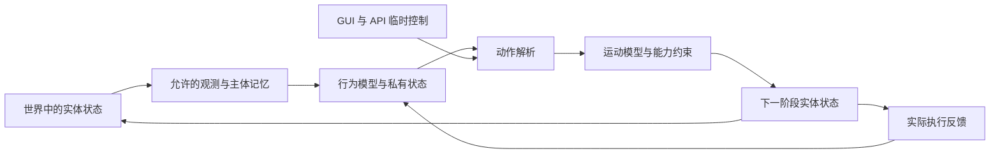
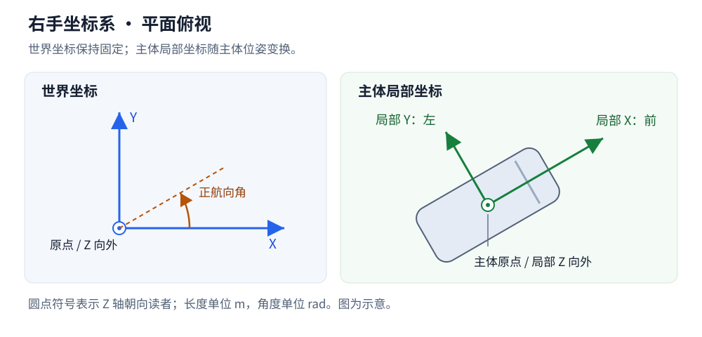

# 主体设计

本文定义实体与 Agent 的关系、主体操作和道路交互能力，供 Rust 内核、GUI 和 Python API 共同使用。系统所有权见[核心设计](core.md)，命令时序与共享控制见[执行与记录](execution.md)。

## 实体与 Agent

实体是世界中具有身份和状态的对象。车辆、非机动车、行人以及独立放置的障碍物都可以作为实体。道路几何和固定设施的基础定义归地图管理，信号相位等可变状态归世界管理，并通过地图身份关联。

Agent 表示实体参与决策与控制的能力。车辆、非机动车和行人使用共同的身份与查询规则，其导航、策略和运动能力分别配置。静态障碍物只需要相应的几何与生命周期数据。

| 数据 | 所属职责 | 主要内容 |
| --- | --- | --- |
| 实体定义 | 场景配置 | 类别、轮廓、运动参数与初始状态 |
| 实体状态 | 世界 | 实体 ID、位姿、速度、道路关联与生命周期 |
| Agent 配置 | 场景配置 | 目标、导航、策略、信息能力与决策周期的初始设置 |
| Agent 运行状态 | 信息与策略 | 当前目标与路线、策略记忆、随机状态、决策计时和持续动作 |
| 查询结果 | 数据接口 | 所选对象在某个状态版本下的基础状态，或相应专题结果 |

Agent 运行状态通过实体 ID 关联世界中的实体。位置、速度和轮廓以世界中的实体状态为准。策略内部估计需要保留其来源和时刻，并遵循允许信息范围。

行为模型产生动作，运动模型执行控制。通用观测记忆与策略私有状态由相应 Agent 持有，实体物理状态由世界统一提交。

公开接口中的 `agent_id` 指向具有 Agent 能力的实体，沿用该实体的身份。主体类别、行为策略和运动模型分别表达，策略切换保留实体身份。

实体状态至少表达身份、类别、位姿、运动、轮廓和生命周期。目标、路线和感知记忆按相应能力查询。不同类别支持的运动字段与动作分别校验，例如车辆转向和行人平面速度具有不同含义。

## 基础状态与运动能力

本节定义基础数据、坐标约定、主体参考点与分类控制接口。具体字段与执行参数按相应运动模型的能力定义。

### 公共状态

| 内容 | 含义与单位 | 数据关系 |
| --- | --- | --- |
| 身份与类别 | 运行身份、实体 ID、主体类别 | 身份保持稳定，类别与模型配置关联 |
| 位姿 | 主体参考点的世界位置，单位 `m`；朝向角，单位 `rad` | 平面原型使用 XYZ 位置与绕 Z 轴的航向 |
| 线速度 | 世界坐标系下的速度向量，单位 `m/s` | 速率和主体纵向速度从该向量派生 |
| 加速度 | 实际运动的加速度向量，单位 `m/s²` | 标明采样时刻或估计区间，与请求控制量分别表达 |
| 角速度 | 平面模型的航向角速度，单位 `rad/s` | 三维模型按能力扩展相应分量 |
| 几何 | 局部轮廓、尺寸、高度及相对参考点的变换 | 世界轮廓由几何和实际位姿生成 |
| 生命周期与运动状态 | 在场、移除等生命周期，以及可运动、事故停驶等运行条件 | 运动状态与全局暂停状态分别表达 |
| 时间与版本 | Tick、状态版本及必要的区间标记 | 可在一批结果的共同元数据中保存 |

世界速度向量保留运动方向。速率表示其模长，纵向速度表示在主体朝向上的有符号分量。车辆倒车、侧向运动和行人朝向与移动方向的差异通过相应字段表达。

场景定义保存轮廓与运动参数等配置，主体查询提供完整基础状态包装对象。目标、路线、策略记忆和道路关系按各自职责通过显式查询取得。

初始状态可以提供速度；运行中的直接状态改写按显式编辑处理。动作给出的目标加速度、目标速度和实际运动结果分别保存，便于检查运动约束与执行偏差。

### 坐标与参考点

世界采用右手坐标系，Z 轴向上，平面航向以 X 正方向为零，朝 Y 正方向旋转为正。主体局部 X 轴向前、Y 轴向左、Z 轴向上。长度、时间和角度分别采用米、秒和弧度，角速度采用 `rad/s`。

主体原点统一采用轮廓几何中心的地面投影。车辆后轴等运动模型参考点由模型配置给出相对变换，轮廓和查询使用同一套主体位姿。位姿投影与道路关系查询明确使用的参考点。

公开状态、生成位置、Transform 和道路查询默认使用主体中心原点。后轴属于特定运动模型的内部计算参考点，调用方可以按需要显式选择相应位置。

外部数据导入和导出在接口边界完成坐标、旋转及单位转换。位置、速度、轮廓与姿态使用一致的变换约定。GUI 屏幕坐标由显示变换处理，内核与 Python API 保持统一的世界坐标。

平面原型采用 Z=0 和航向角。道路高程、俯仰与侧倾由对应的地图与运动能力提供。三维姿态表示和高程跟随规则在高程模型中细化。

### 分类控制接口

| 主体或能力 | 基础输入 | 运动配置与专属状态 |
| --- | --- | --- |
| 机动车 | 纵向加速度与等效前轮转向角 | 轴距、转向及加速度约束，必要的转向执行状态 |
| 转向受约束的非机动车 | 与自身模型匹配的加速度与转向输入 | 轮廓、几何参数及速度、转向约束 |
| 行人或自由平面运动主体 | 目标速度向量，或平面加速度向量 | 速度与加速度约束，以及朝向更新规则 |
| 轨迹执行能力 | 带时间的位姿与必要运动字段 | 轨迹跟踪参数、偏差和实际生成的控制 |

输入采用有物理单位的量。目标速度由相应控制器转为运动输入，实际速度按运动模型与时间步更新。转向角、曲率和航向角速度具有各自含义，转换关系由具体运动模型定义。

机动车与非机动车的类别用于表达交通语义，运动能力由各自配置声明。行人的目标速度控制与加速度控制作为不同动作方式处理。轨迹与直接控制沿用完整控制组的解析规则。

油门、制动和档位等执行器输入可以随相应车辆模型引入。采用此类输入时，需要一并定义执行器到实际运动的关系。首轮优先验证加速度与转向输入，以及有界平面运动。

主体初始化时设置与其运动模型匹配的能力范围，包括速度、加减速、转向及适用的变向约束。参数在加载和创建时校验，具体值通过主体或车型配置给出。

模型参考点、参数、动作执行与数值推进的具体方案见[运动模型](motion.md)。

### Rust 类型组织

使用公共实体状态组合分类运动状态：公共部分表达身份、位姿、运动结果与几何引用；车辆转向执行状态等数据归相应运动模型管理。动作使用分类枚举表达输入形式，接收时检查主体能力、单位与执行区间。

主体状态、模型参数和动作类型各自维护清楚的字段。主体查询生成本地只读基础状态对象，具体数值类型与数组布局在内核和传输实现中确定。

## 主体操作

操作通过统一命令入口提交，采用批量接收和带版本的结果。下表描述领域能力，具体方法名、参数和返回类型随接口设计确定。

| 能力 | 输入与语义 | 结果与约束 |
| --- | --- | --- |
| 创建 | 实体定义、初始位姿、运动配置，以及可选的 Agent 配置 | 验证成功后建立实体并返回身份，记录实际生效边界 |
| 移除 | 实体身份与原因 | 结束世界生命周期，清理相关运行状态并产生事件 |
| 设置目标 | 目的地、目标区域或行为目标 | 更新导航任务，由相应规划与策略生成后续运动 |
| 设置路线 | 显式道路路径或区域序列 | 校验引用与连接，更新 Agent 的参考路线与相应版本 |
| 设置策略 | 策略身份、参数及运行状态切换方式 | 保留实体与物理状态，明确处理记忆、随机状态及持续动作 |
| 直接控制 | 与主体运动模型匹配的控制量和执行区间 | 按控制组解析，返回实际有效输入与约束诊断 |
| 提交轨迹 | 时间、坐标系、采样状态和执行区间 | 校验时序与连续性，由轨迹执行器生成运动输入 |
| 结束外部动作 | 指定持续动作或轨迹的身份 | 在确认的边界结束其有效性，后续输入按明确的策略规则产生 |
| 显式状态编辑 | 位姿及必要的运动状态 | 作为场景干预记录，更新相关派生关系 |

目标与路线描述导航意图。直接控制与轨迹描述运动输入。偏离路线或违反交通规则的实际运动继续由内核计算，合法性通过独立的规则与事件表达。

显式状态编辑需要完整校验受影响字段的一致性。原型阶段将该操作限定在暂停状态，便于清楚区分场景编辑与连续运动。创建、移除和目标变更可以在运行边界执行，控制回合的固定版本规则保持有效。

初始位置位于道路外属于有效的场景条件。位置与已有对象重叠时需要返回明确诊断，并按场景允许条件与接触规则处理。数值无效、对象身份失效或动作能力不匹配属于错误。

移除实体时，同时结束其决策参与及待执行的主体动作，并记录生命周期结果。指向已移除实体的后续操作明确返回错误。事故停驶仍保留实体身份与空间占用，清除操作结束其世界生命周期。

### 操作完整性与返回

创建输入将实体定义、初始状态、运动参数与初始策略作为一个完整对象校验，成功后一次建立相应运行状态。执行结果返回实体身份和实际生效版本，批量创建返回逐项结果。

目标更新以一个完整导航目标为单位，路线更新以一个带版本的路线为单位。目标、路线、策略配置与运动控制分别提交，彼此通过明确的引用和前置条件关联。策略切换初始化新策略的私有状态，保留实体物理状态和通用观测记忆，具体模型负责声明所支持的状态衔接。

显式状态编辑同时校验位姿、速度与模型专属状态的一致性。校验成功后统一提交，并更新或失效相关道路关系和空间索引。编辑结果保留修改前后版本，逻辑时间保持不变。

重复移除已经结束生命周期的实体返回对象失效错误。取消已结束的接管返回无变化，取消结果保留原接管身份与结束原因。运行故障状态下的操作按诊断、重置和加载的系统规则处理。

## 默认行为与临时接管

Agent 创建时具有默认行为模型及相应运行状态。GUI 和 API 的干预分为临时接管与行为模型变更，两者共用命令和动作执行入口。

| 操作 | 含义 | 结束后的行为 |
| --- | --- | --- |
| 临时接管 | 在指定区间提供控制、轨迹或临时策略，保留默认行为模型配置 | 到期或显式结束后，由当时配置的默认行为模型基于当前状态产生动作 |
| 行为模型变更 | 修改默认行为模型及参数，明确处理对应运行状态 | 后续持续使用新配置，直到再次变更 |

临时接管保留默认行为模型的身份与运行上下文。到期处理只结束相应接管记录。恢复控制时使用接管结束后的实际位置、运动与信息，历史动作已经完成各自的执行区间。

API 负责构造临时操作，内核保存其生效区间、行为上下文与恢复安排。到期执行复用统一切换机制，恢复计划进入运行记录与检查点。不同客户端读取相同的仿真状态和处理结果。

接管期间修改默认行为模型时，新配置成为后续交还控制的目标。接管结束保持该次配置变更有效。这样可以通过相同机制实现临时与长期干预，并保留清楚的操作语义。

简单控制动作默认作用于当前控制区间，持续接管显式给出有效区间或采用手动结束。轨迹覆盖相应的接管区间，到期后交还当前默认行为模型，具体规则见[轨迹接口与执行](motion.md#轨迹接口与执行)。临时接管的存在独立于 Python 控制回合，空批次保持“本回合没有新增干预”的含义。

接管按动作类型规定的控制组生效。车辆直接控制包含纵向加速度与目标转向角，同行为方式内的独立字段可以分别覆盖。行人目标速度向量、行人加速度向量和短时轨迹各自作为完整输入处理。动作方式切换需要提交对应的完整控制组，缺失必需字段明确报错。

默认行为模型为需要计算的控制量提供基础输入，有效临时接管覆盖相应输入。GUI 与 Python 的接管共用接收顺序，同一窗口中的冲突按统一覆盖规则处理。基础策略的后续更新保持已生效接管的有效性。

临时接管使用独立身份，区间采用起点包含、终点排除的形式。单 Tick 接管在边界 `k` 开始，在边界 `k+1` 结束。到期、显式取消、替换和主体移除分别记录结束原因。

新接管在实际生效时替换同一控制量上的旧接管，被替换部分结束。彼此独立的控制量可以保留各自来源。旧接管的自动恢复不属于基础规则，接管结束后由当前默认行为模型补足所需输入。完整轨迹与直接控制的切换按完整控制组处理。

## 策略输入与运行记忆

### 模型与状态

策略计算可以表达为“允许的输入、旧状态与随机输入，产生动作和新状态”。这个表达支持逐步更新，每次调用只处理所需的新信息和既有状态。

通用记忆属于 Agent，观测、消息、跟踪与实际执行历史按各自更新规则持续维护。行为模型读取允许的记忆并产生动作，模型可以切换。模型切换保持 Agent 通用记忆的身份与内容。

| 内容 | 示例 | Rust 中的持有方式 |
| --- | --- | --- |
| 模型与配置 | 规则算法、网络权重、行为参数 | 模型资源按需共享，配置关联对应 Agent |
| 通用主体记忆 | 历史观测、已到达消息、目标跟踪、实际动作历史 | 每个 Agent 独立持有，按允许信息更新 |
| 策略私有状态 | 等待计时、行为阶段、循环网络隐藏状态、规划进度 | 由对应 Agent 的策略运行上下文持有 |
| 可重建缓存 | 派生特征、中间计算和加速索引 | 随输入版本校验，可按规则重建 |

主体状态包含影响后续决策的信息。会改变动作结果的隐藏状态属于策略私有状态，需要纳入检查点。只有按相同输入可以重建且保持行为语义的数据才属于缓存。

策略私有状态也由相应 Agent 的运行上下文持有，按模型的类型和身份管理。不同模型可以使用不同的私有状态结构。通用记忆的持续更新与模型专属隐藏状态的更新分别执行，所需更新频率由模型能力说明。

Rust 接口可以只读借用模型与输入，并原地更新当前 Agent 的私有状态。显式的状态输入输出语义不要求复制完整记忆、反复加载权重或重新计算全部历史。无记忆策略使用空状态即可。

随机采样使用 Agent 对应的随机状态，实际执行反馈用于更新与动作相关的状态。策略提出的候选动作与最终执行动作分别记录，策略根据实际结果维护自身历史。

### 接管与状态衔接

接管期间，主体继续运动和获取允许的信息，通用观测记忆按原有采样与更新规则维护。策略私有状态的维护方式由模型能力声明。

原型参考策略在完整接管时暂停默认决策计算，保留其运行上下文。交还控制时传入当前信息、经过的逻辑时间、实际执行反馈和接管结束标记。默认策略在继续决策前完成相应的状态衔接。

策略需要声明支持的衔接方式：保留状态继续、执行专门的恢复更新，或显式重新初始化。部分模型需要连续更新隐藏状态，其接管期间的更新可以继续执行，生成的动作按当前接管规则处理。策略能力与运行配置共同确定这一行为，并随实验记录保存。

更换行为模型时，新模型按自己的状态定义初始化。通用观测记忆继续属于该 Agent。跨模型的私有状态迁移需要明确的转换定义；直接复用不兼容的隐藏状态按错误处理。

原型采用状态少、衔接规则明确的参考策略，具体范围见[技术原型方案](prototype.md#原型参考策略)。后续模型分别声明自己的更新与衔接能力。

## 道路关系与几何查询

### 关系分类

主体与路网的交互包括几何定位、占用判断、导航关联和交通规则查询。实际位姿与轮廓是几何计算的依据，目标和路线提供导航上下文。

| 关系 | 含义 | 结果 |
| --- | --- | --- |
| 几何投影 | 将主体参考点或任意位置投影到指定道路曲线 | 曲线身份、纵向位置、有符号横向偏移、切向与航向差 |
| 位置归属 | 判断参考点与车道、路面或区域的包含关系 | 零个、一个或多个候选，以及匹配依据 |
| 轮廓占用 | 判断主体完整轮廓与通行区域的空间关系 | 所占车道或区域、越界情况及相关几何结果 |
| 拓扑与规则 | 查询邻接、连接、通行类别与信号关联 | 所需路径或规则数据及其适用条件 |

换道时主体轮廓可以同时占用多条车道。路口可以存在多个合理的几何候选。道路外位置可以返回空归属，同时保留搜索范围内的邻近投影结果。最近曲线、位置归属和导航选择分别返回各自的含义。

投影需要明确主体参考点、目标曲线、纵向坐标原点和横向正方向。道路参考线纵坐标与车道中心线弧长分别定义，结果携带相应参考曲线身份与方向。

候选筛选需要考虑空间距离、高程和查询范围。朝向与路线可以参与导航匹配，逆行等实际状态仍保留相应的几何关系。违反通行规则按规则查询产生结果。

### 查询输入与范围

主体关系查询默认使用主体原点，允许显式选择模型提供的后轴等参考点。轮廓占用查询使用完整几何。任意位置查询提供世界位置，航向与轮廓作为相应查询的可选输入。

| 查询 | 输入范围 | 返回含义 |
| --- | --- | --- |
| 指定参考曲线投影 | 道路或车道参考曲线、查询位置 | 在明确曲线上计算纵向位置与横向关系 |
| 邻近候选查询 | 世界位置、搜索距离、对象类别与结果数量上限 | 返回搜索范围内的参考曲线及几何关系 |
| 位置归属查询 | 参考点、车道或通行区域的筛选条件 | 返回实际包含该点的车道与区域 |
| 轮廓占用查询 | 主体或世界轮廓、候选通行区域 | 返回轮廓实际重叠或接触的车道与区域 |

搜索距离和结果数量采用显式参数或有记录的查询默认值。返回结果标明实际搜索范围及是否因数量上限截断。无匹配属于正常结果，失效的地图引用、非法范围和所请求能力未受支持按错误处理。

几何候选按距离及稳定身份确定展示顺序，Agent 自行选择导航参考。结果边界允许多个包含候选，跨车道轮廓返回多个占用关系。道路外对象保持空归属，邻近查询仍可返回范围内的曲线。

### 纵横向坐标与结果

| 字段 | 约定 |
| --- | --- |
| 参考身份 | 地图版本、道路或车道身份、参考曲线类型及其方向 |
| `road_s`、`road_t` | 源道路参考线坐标，纵向从该道路参考线起点计算，横向以参考线左侧为正 |
| `lane_s` | 从选定车道中心参考曲线起点，沿该曲线方向计算的平面弧长 |
| `lateral_offset` | 相对选定参考曲线的有符号横向距离，曲线方向左侧为正，单位 `m` |
| `heading_error` | 主体航向减去参考曲线切向角，归一化到 `[-π, π)`，单位 `rad` |
| 几何结果 | 投影位置、切向、实际距离及是否位于曲线端点 |
| 归属与占用 | 参考点包含关系、轮廓关系与需要的越界诊断 |

车道中心参考曲线可以与道路参考线具有不同的方向和长度，二者的纵向坐标分别计算。双向通行区域使用明确选定的参考曲线方向，允许的通行方向通过规则表达。

投影限于参考曲线的有效区间，最近点在端点时明确标记。横向偏移和到曲线的实际距离分别返回，端点之外的位置继续保留自己的世界位置。

返回的道路与车道身份在对应地图版本内有效，源道路、车道段和车道标识另行提供以便追溯。道路查询与主体状态使用同一世界版本，查询过程保持只读。

### 计算、缓存与运行状态

几何关系由地图和实体位姿计算。地图维护可复用的空间索引；主体移动时，可以利用上次候选及其拓扑邻域缩小搜索范围，再按查询范围补充候选。具体索引和投影算法按地图精度与规模选择。

常用关系可以缓存到相应状态版本，供多个策略、GUI 和 Python 查询复用。缓存记录实体状态版本、地图版本及计算规则。位姿编辑、地图变化或版本不匹配使缓存失效，读取前重新计算有效结果。

导航匹配可以保留上次参考路径、路线进度和候选选择历史，以表达连续的导航状态。影响后续决策的匹配历史随检查点保存；纯几何查询缓存可以重建。匹配结果应表达歧义与匹配丢失等正常状态。

道路关联的更新保持主体实际位姿。自动吸附和位置调整不属于几何定位操作。

### 寻路工具与 Agent 导航

路网模块提供几何、拓扑、通行条件及基础寻路算法，按照调用方给定的起终点、约束和代价返回参考路线。几何查询结果保持对实际空间关系的描述。

Agent 的导航与行为策略决定使用哪些工具、选择哪个车道或区域、何时重新寻路，以及怎样响应偏离路线的情况。参考路线作为决策输入，实际运动由 Agent 的动作及运动模型产生。

错过路口、意外走错路、继续原方向或主动重新规划，均可以由不同策略表达。平台保留实际位置、占用与规则判断，导航工具的返回结果不直接改写主体运动。

导航匹配与路线进度属于 Agent 的运行状态，相应策略可以组合路线、几何候选与历史。首轮参考策略的具体选择在行为模型中定义，平台接口保持通用能力边界。

Agent 策略可以作为 Rust 内核中的普通实现运行，也可以通过 Python 接口提供动作。策略属于可替换的行为逻辑，路网算法属于可复用工具，两者在内核中按职责组织。

## Python 与 Rust 接口映射

Python 通过 `Query` 选择主体集合，返回完整基础状态对象；道路关系等专题通过显式查询取得。预定义查询与动态查询共用相同语义。主体道路关系随结果携带运行身份、状态版本和地图版本。任意位置的地图投影查询与现有主体的关系查询可以共用底层几何能力。

Rust 中由 `Map` 提供只读几何、拓扑和规则查询，`World` 提供实体位姿与轮廓，导航运行状态归相应主体管理。`Simulation` 组织版本校验、关系更新和查询结果生成。

命令采用有类型的主体操作与动作变体，例如创建、移除、设置目标、设置路线、设置策略、编辑状态以及直接控制和轨迹。查询描述与查询结果分别定义，外部结果使用可传输的数据。

精确世界位置得到的道路关系属于世界真值。有限信息策略需要从允许的自身定位估计与地图信息计算相应关系，并保留误差与来源。策略的可见信息边界同样适用于道路关系。

控制组使用本章定义的基本语义，具体传输字段随接口类型细化。轨迹跟踪算法与误差范围通过验证确定，各类行为模型的私有状态衔接由对应模型声明。
