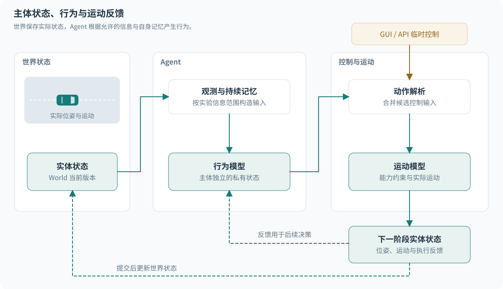

# 主体设计

本文定义实体与 Agent 的关系、主体操作和道路交互能力，供 Rust 内核、GUI 和 Python API 共同使用。系统所有权见[核心设计](../core.md)，命令时序与共享控制见[执行与记录](../execution.md)。

## 阅读结构

| 文档 | 内容 |
| --- | --- |
| 本文 | 实体与 Agent 的职责、数据所有权及接口映射 |
| [状态与道路关系](state.md) | 公共状态、坐标、运动能力、投影与导航查询 |
| [行为与控制](behavior.md) | 主体操作、默认模型、临时接管与策略记忆 |
| [模型接入与任务](policies.md) | 多层指令、研究边界、决策周期、目标生命周期与可选恢复 |
| [运动与接触](motion.md) | 运动模型、输入约束、数值推进与事故占用 |
| [轨迹编制与执行](trajectory.md) | 关键点草稿、时间安排、约束、轨迹提交与跟踪反馈 |

## 实体与 Agent

实体是世界中具有身份和状态的对象。车辆、非机动车、行人以及独立放置的障碍物都可以作为实体。道路几何和固定设施的基础定义归地图管理，信号相位等可变状态归世界管理，并通过地图身份关联。

Agent 表示实体参与决策与控制的能力。车辆、非机动车和行人使用共同的身份与查询规则，其导航、策略和运动能力分别配置。静态障碍物只需要相应的几何与生命周期数据。

| 数据 | 所属职责 | 主要内容 |
| --- | --- | --- |
| 实体定义 | 场景配置 | 类别、轮廓、运动参数与初始状态 |
| 实体状态 | 世界 | 实体 ID、位姿、速度、道路关联与生命周期 |
| Agent 配置 | 场景配置 | 目标、导航、策略、信息能力与决策周期的初始设置 |
| Agent 运行状态 | 信息与策略 | 当前目标与路线、策略记忆、随机状态、决策计时和持续动作 |
| 查询结果 | 数据接口 | 所选对象在某个状态版本下的基础状态，或相应专题结果 |

Agent 运行状态通过实体 ID 关联世界中的实体。位置、速度和轮廓以世界中的实体状态为准。策略内部估计需要保留其来源和时刻，并遵循允许信息范围。



<details>
<summary>图示源码（Mermaid）</summary>

```text
flowchart LR
    WORLD[世界中的实体状态] --> INFO[允许的观测与主体记忆]
    INFO --> POLICY[行为模型与私有状态]
    POLICY --> RESOLVE[动作解析]
    EXTERNAL[GUI 与 API 临时控制] --> RESOLVE
    RESOLVE --> MOTION[运动模型与能力约束]
    MOTION --> NEXT[下一阶段实体状态]
    NEXT --> WORLD
    NEXT --> FEEDBACK[实际执行反馈]
    FEEDBACK --> POLICY
```

</details>

行为模型产生动作，运动模型执行控制。平台通用信息与内置策略状态由内核持有，外部 Python 私有状态由研究程序持有。数据通过主体身份关联，实体物理状态由世界统一提交。

公开接口中的 `agent_id` 指向具有 Agent 能力的实体，沿用该实体的身份。主体类别、行为策略和运动模型分别表达，策略切换保留实体身份。

实体状态至少表达身份、类别、位姿、运动、轮廓和生命周期。目标、路线和感知记忆按相应能力查询。不同类别支持的运动字段与动作分别校验，例如车辆转向和行人平面速度具有不同含义。

## Python 与 Rust 接口映射

Python 通过 `Query` 选择主体集合，返回完整基础状态对象；道路关系等专题通过显式查询取得。预定义查询与动态查询共用相同语义。主体道路关系随结果携带运行身份、状态版本和地图版本。任意位置的地图投影查询与现有主体的关系查询可以共用底层几何能力。

Rust 中由 `Map` 提供只读几何、拓扑和规则查询，`World` 提供实体位姿与轮廓，导航运行状态归相应主体管理。`Simulation` 组织版本校验、关系更新和查询结果生成。

命令采用有类型的主体操作与动作变体，例如创建、移除、设置目标、设置路线、设置策略、编辑状态以及直接控制和轨迹。查询描述与查询结果分别定义，外部结果使用可传输的数据。

精确世界位置得到的道路关系属于世界真值。有限信息策略需要从允许的自身定位估计与地图信息计算相应关系，并保留误差与来源。策略的可见信息边界同样适用于道路关系。

控制组使用[行为与控制](behavior.md)定义的基本语义，具体传输字段随接口类型细化。轨迹跟踪算法与误差范围通过验证确定，各类行为模型的私有状态衔接由对应模型声明。
