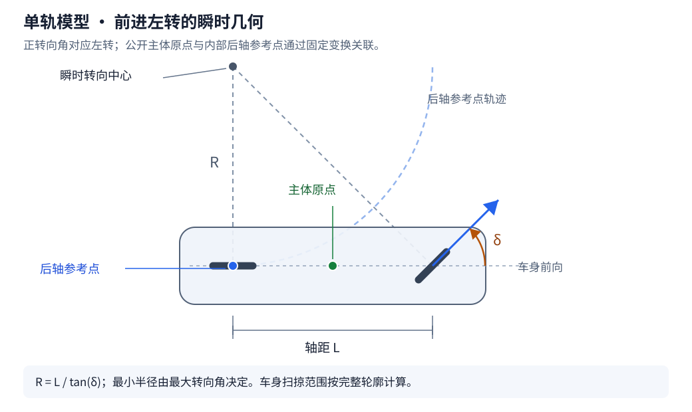

# 运动模型

本文定义首轮运动模型、参数、控制与约束，给出数值推进及验证要求。主体状态与操作见[主体设计](README.md)，逻辑步和命令解析见[执行与记录](../execution.md)。

## 模型范围

首轮采用平面运动学模型，关注连续位置、转向、制动和交通交互。运动模型接收最终解析的输入，生成实际运动状态与区间运动信息。

Movara 面向交通管理与混合交通交互。机动车采用能够表达尺寸、转向、加减速和空间占用的简单模型。车辆动力学精度不作为模型发展的目标。

非机动车与行人的细化围绕通行空间、启动与停止、变向、间隙选择、穿行及对其他主体的响应展开。运动约束归运动模型，行为选择归相应策略，校准与评价见[行为模型](../models.md)。

| 主体 | 模型方案 | 执行输入 |
| --- | --- | --- |
| 机动车 | 前轮转向的运动学单轨模型 | 纵向加速度与目标等效前轮转向角 |
| 转向受约束的非机动车 | 独立参数配置的运动学单轨模型 | 与自身配置匹配的加速度和目标转向角 |
| 行人 | 有界平面运动 | 世界坐标系下的目标速度向量或加速度向量 |

车辆与非机动车可以复用同一类数值算法，各自保留类别、轮廓、能力和行为模型配置。首轮原型验收以车辆和行人为主，非机动车按对应场景补充验证。

该方案描述交通层运动。轮胎侧滑、悬架、两轮平衡和碰撞力学不属于核心范围。模型适用性通过交通场景与数值案例验证。

## 车辆与转向主体

### 参考点与状态

单轨模型在后轴中点定义内部参考点，状态包括该点的平面位置、车身航向、有符号纵向速度和实际转向角。公开主体原点沿用轮廓几何中心的地面投影，两者通过配置中的固定变换关联。

主体的公开 Transform、创建位置和默认查询均使用中心原点。后轴参考点仅服务该模型的计算，转换由内核完成。

模型以车身航向和后轴速度确定后轴运动，以轴距和实际转向角确定航向变化。前进时正转向角对应左转，倒车时运动按相同几何关系计算。

```text
dx_rear/dt = v * cos(yaw)
dy_rear/dt = v * sin(yaw)
dyaw/dt = v * tan(steering_angle) / wheelbase
dv/dt = acceleration
```

公共位姿和速度由内部参考点状态转换得到。转弯时，主体中心与后轴的速度包含由角速度和相对偏移产生的差异，结果需要按各自参考点计算。



图中 R 表示后轴参考点的轨迹半径，主体中心与车身外轮廓具有各自的运动轨迹。

### 参数

| 参数 | 含义 |
| --- | --- |
| `wheelbase` | 前后轴距离，单位 `m`，取正值 |
| `rear_axle_offset` | 主体原点到后轴中点的局部坐标变换 |
| `speed_min`、`speed_max` | 有符号纵向速度的允许范围，单位 `m/s` |
| `acceleration_min`、`acceleration_max` | 纵向加速度输入范围，单位 `m/s²` |
| `steering_angle_max` | 等效前轮转向角绝对值上限，单位 `rad`，小于 `π/2` |
| `steering_rate_max` | 实际转向角变化率上限，单位 `rad/s` |

### 初始化与能力约束

主体创建时确定模型参数与限制范围。场景可以引用车型或主体类别预设，并显式覆盖允许的参数。加载与创建阶段完成取值、初始状态和参数关系校验；运行记录保存解析后的完整配置。

速度范围包含静止状态，加速度范围包含零值，转向角与转向速率上限取正值。轴距、轮廓尺寸和参考点偏移需要相互一致。初始速度与转向状态必须满足对应范围。

车辆的最小转弯半径以后轴参考点为准，通过轴距和最大转向角得到：`turning_radius_min = wheelbase / tan(steering_angle_max)`。配置也可以使用最小转弯半径描述转向能力，加载时将其转换为最大转向角。两者同时提供时校验一致性，矛盾配置明确报错。

外部车型数据中的转弯半径需要注明测量参考点，导入时转换为模型定义的参考点。

车身外轮廓的扫掠范围根据实际尺寸、参考点偏移和运动计算。道路净空与空间占用检查使用完整轮廓，后轴转弯半径用于描述模型的转向能力。

行人及其他运动模型同样在初始化时明确自己的速度、加减速和变向能力，参数按模型适用范围定义。不同主体允许使用不同的能力预设。

### 控制执行

输入包含纵向加速度与目标转向角。实际转向角以配置的变化率向目标更新，运动使用实际转向角。零速时可以调整转向角，主体航向由运动关系确定。

纵向加速度表示有符号速度的变化率。前进减速使用负加速度，倒车减速使用正加速度。速度下界为零的配置在减速至零后保持停车；允许负速度的配置支持倒车，控制方需要根据目标表达相应输入。

转向角与车辆方向盘转角分别表达。首轮接口采用等效前轮角，方向盘和执行器模型按相应能力扩展。

## 行人平面运动

行人状态包括位置、世界速度向量与朝向，参数包括速度上限、加速度上限和朝向更新规则。

目标速度模式以当前速度和目标速度的差计算本区间所需加速度，并依据加速度能力逐步接近目标。停止目标采用零速度向量，停止过程保持配置的减速约束。

直接加速度模式按提交的世界平面向量更新速度与位置。目标速度与直接加速度属于两种完整动作方式，同一执行区间采用其中一种。

首轮移动时朝向沿实际速度方向更新，静止时保留已有朝向。朝向用于主体位姿与轮廓变换，运动方向由实际速度决定。独立面向控制和转身速率约束按后续模型能力扩展。

## 验证与约束反馈

输入校验与运动约束分别处理。

| 情况 | 处理方案 |
| --- | --- |
| 非有限数值、失效身份、模型能力不匹配 | 返回错误，保持此前有效候选输入 |
| 控制请求超出声明的输入范围 | 返回错误并说明字段与允许范围 |
| 有效目标转向角需要时间才能达到 | 按转向变化率执行，返回实际转向角 |
| 行人目标速度需要逐步达到 | 按加速度能力执行，返回实际速度与加速度 |
| 运动达到配置的速度边界 | 按边界约束处理后续区间，记录受约束原因与实际运动 |
| 正常运动产生交通违规 | 保留运动结果，按规则生成事件 |

目标速度模式中的加速度限制属于该控制方式的定义。它与拒绝超范围的直接加速度输入具有不同语义。限速标志等交通规则通过行为策略和规则评价处理，运动模型中的速度边界表示所选模型能力。

执行反馈保留请求输入、有效输入、实际控制状态、执行区间和约束原因。实际加速度查询明确采样时刻或估计区间；初始状态的缺失估计需要明确标记。接触造成的状态变化按接触模型单独记录。

| 反馈内容 | 字段语义 |
| --- | --- |
| 身份与来源 | 运行、主体、动作或轨迹身份，以及来源和关联命令 |
| 时间与版本 | 起止 Tick、秒数区间、输入状态版本与输出状态版本 |
| 输入解析 | 原始请求、最终有效控制及合并或覆盖结果 |
| 执行状态 | 实际加速度、转向等模型支持的控制状态 |
| 运动结果 | 起止主体中心状态及所需区间运动描述 |
| 约束与诊断 | 受约束字段、原因、错误及关联事件 |
| 轨迹反馈 | 参考时刻、参考状态和实际跟踪偏差 |

不同动作返回适用的反馈内容，基础状态查询继续使用统一对象。记录保留足够的执行依据，查询可以按专题取得相应反馈。

## 数值推进与接口

世界采用配置中的固定 `dt`，运动计算可以在一个 Tick 内使用确定的子步。子步用于数值积分与区间接触查询，外部控制回合仍按原逻辑边界提交。

首轮采用 CPU 上的双精度计算，并验证中点积分等简单方法。内部子步上限与积分方案随运行配置保存，具体数值通过误差与成本验证确定。控制输入在声明区间内按动作定义执行，转向执行状态随积分更新。

速度到达边界或控制有效区间结束时，需要按实际时刻处理剩余区间。更新位置和航向应使用对应区间的运动过程，单独截断最终速度无法完整表达该过程。

运动结果提供起止状态和可供区间查询使用的运动描述，接触阶段据此检查途中接触。首次接触与占用规则见下节。

Rust 中将模型参数、模型运行状态和分类控制输入分别定义。运动函数读取固定的阶段输入，输出候选状态、运动区间与诊断，由仿真阶段统一提交。Python 与 GUI 读取相同的执行反馈。

轨迹先由执行器转换为相应模型支持的输入，再通过相同运动边界执行，具体约定见[轨迹接口与执行](trajectory.md#轨迹接口与执行)。

## 接触与事故占用

### 首次接触与停止

接触检测使用完整主体轮廓，覆盖动态主体、静态障碍与事故占用对象。首轮在同一空间层内根据平面轮廓定位首次接触，高程场景按其空间能力判断。

一次 Tick 内以最早接触时刻为分段边界，先将相关运动推进到该时刻，再将涉事动态主体设为事故停驶。主体保留接触位置与轮廓，速度和有效运动输入切换为停止状态，其余主体继续完成剩余区间。

接触后的状态会改变后续运动条件，剩余区间的候选与接触需要依据更新后的占用继续检查。例如车辆先撞停，后车在同一 Tick 内接近事故对象时，仍可能产生新的接触。时刻在数值容差内相同的接触统一处理涉事主体集合，保持顺序规则明确。

停止是首轮事故模型的显式规则，状态突变、发生时刻和原因随事件记录。碰撞力、反弹、损伤与冲量不由该模型估计。

### 接触过程与数值容差

接触过程具有独立身份，区分开始、持续和结束。同一对对象保持接触时保留原过程身份，持续状态可以查询。接触开始事件仅在进入接触过程时产生，分离或实体移除时结束该过程。

首次接触定位使用明确的几何与时间容差，容差随运行条件保存。停止位置取检测方法确认的接触边界，残余误差在诊断中表达。自动平移分离和无记录的位置修正不属于基础规则。

场景初始重叠在加载校验中报告，默认按场景错误处理。需要研究初始占用或事故重叠的场景可以显式允许，并在运行起点建立接触与停驶状态。故意构造的初始关系保留配置与事件来源。

### 持续运行与清除

事故停驶主体继续参与空间查询、可见信息生成和接触检测。普通运动控制无法解除事故停驶状态，操作返回相应状态错误。其他主体按其策略选择等待、绕行或改道。

首轮清除通过显式移除涉事实体结束空间占用，记录清除原因、原实体与相关接触过程。恢复驾驶、拖离和运输组合体属于后续事故处置能力。

默认情况下，事故发生后全局逻辑时间继续推进。场景可以配置事故后暂停选项，暂停在完成当前 Tick 的边界生效，事故事件仍保留区间内的实际时刻。Python 回调可以基于同一事件执行其他交通管理干预，方式见[事件与回调](../../python-api/events.md)。任务终止和运行故障具有各自的系统语义。

## 验证案例

| 案例 | 观察内容 |
| --- | --- |
| 匀速直行与恒加速度 | 位移、速度与解析关系一致 |
| 减速停车与倒车配置 | 停车时刻、剩余区间及速度符号符合配置 |
| 恒速固定转向角 | 转弯半径、旋转方向及参考点转换正确 |
| 目标转向角变化 | 实际转向速率符合上限 |
| 初始化与转弯能力配置 | 超范围初始状态和矛盾配置报错，半径与转向角转换一致 |
| 行人起步、停止与变向 | 速度和加速度约束保持有效 |
| 轨迹跟踪与滚动替换 | 参考与实际状态分别记录，切换使用实际状态并保持运动连续 |
| 轨迹到期与显式取消 | 在确认边界交还控制，终点状态按实际执行结果保留 |
| 同一输入缩小时间步与子步 | 误差随数值条件变化满足验收要求 |
| 高速通过与轮廓占用 | 区间查询覆盖中途运动及主体完整轮廓 |
| 首次接触与同 Tick 后续接触 | 涉事主体在接触处停止，后续查询使用新的占用 |
| 持续接触与清除 | 接触身份稳定，开始事件保持单次，清除结束占用 |

模型参数由样例配置明确给出，验证案例使用可解释的参数。不同主体的现实参数与行为真实性在对应模型评价中确定。
