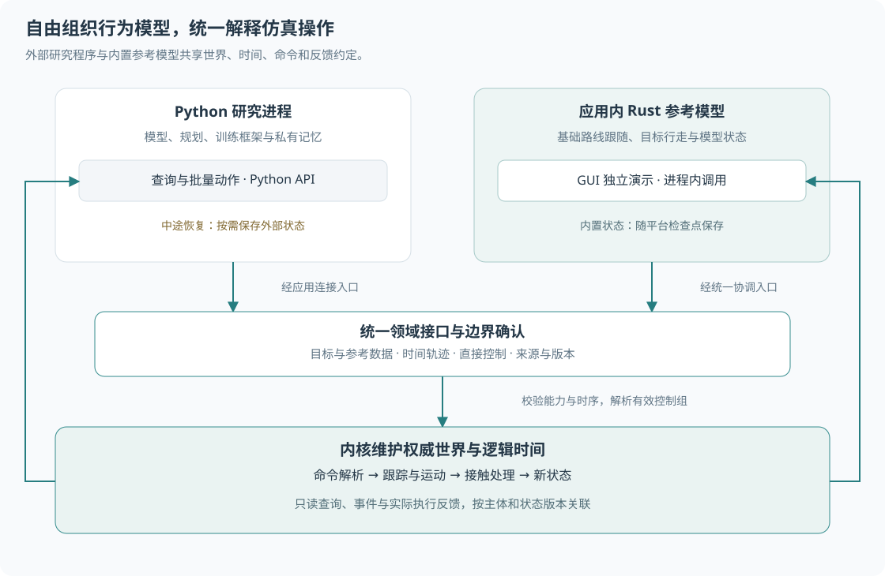

# 模型接入与任务

本文定义行为模型使用 Movara 的方式、决策时序、任务生命周期与参考实现范围。主体操作和接管规则见[行为与控制](behavior.md)，运动执行见[运动与接触](motion.md)，研究评价见[行为模型](../models.md)。

## 平台与研究代码

交通仿真需要统一的物理事实、逻辑时间和可解释的干预结果。行为研究需要自由选择内部表示、模型结构与计算方法。Movara 将统一约定放在查询、命令、执行与反馈的边界。

| 部分 | Movara 提供的能力 | 研究实现负责的内容 |
| --- | --- | --- |
| 世界与时间 | 地图、实体、信号、固定版本查询、Tick 与运行调度 | 实验组织、研究区域与采样方案 |
| 信息 | 世界真值与允许信息的查询边界；后续可组合的可见性、采样及误差组件 | 感知、融合、预测、信念与信息利用算法 |
| 导航与规划 | 基础路网寻路、空间查询、路径及轨迹数据约定，声明能力范围的生成工具 | 目的地选择、路线采用、重新规划、交互与代价设计 |
| 控制与运动 | 多层指令、接管解析、轨迹跟踪、运动约束、接触和实际反馈 | 决策模型、控制算法、风格、风险与让行策略 |
| 实验与记录 | 操作来源、事件、状态、动作记录及平台状态检查点 | 指标、奖励、训练流程、模型校准与外部状态恢复 |

内核负责领域数据和执行规则，应用负责连接和调度，Python API 负责语言对象、批量操作与调用便利性。参考策略可以使用平台提供的工具组合行为。研究算法按自身任务组织代码。

Python 程序通过普通查询和批量动作即可控制主体。程序可以使用函数、类、生成器、神经网络、集中式规划器或其他组织方式。模型注册、共同基类与私有状态结构均属于可选的工具约定。普通 API 调用没有这些前提。

Python 回调在调用方执行。Rust 参考策略在应用持有的运行上下文中执行。早期接入沿用这两条路径，具体插件 ABI、内嵌 Python 和跨机器推理调度另行评估。

## 指令层次与自主能力

一个主体可以接受多个层次的干预。输入层次取决于已有执行能力和实验需要。

| 层次 | 输入示例 | 执行所需能力 |
| --- | --- | --- |
| 任务与意图 | 前往目标区域、保持等待、期望速度 | 能够解释相应任务的行为模型 |
| 参考路线与路径 | 道路连接序列、空间路径或通过点 | 能够采用参考并生成运动的规划器或策略 |
| 短时轨迹 | 带时间的中心位姿与速度序列 | 与运动模型匹配的轨迹跟踪器 |
| 运动控制 | 车辆加速度与转向、行人目标速度 | 对应运动模型的控制入口 |

目标、路线和通过点具有各自的数据语义。模型声明自己能够解释的输入类型。尚未配置执行能力时，设置可保存的参考数据仍可成功；请求执行相应任务时返回能力缺失诊断。命令确认分别报告数据更新和任务执行的结果。

例如，车辆可以由 Python 规划轨迹并由内置跟踪器执行；另一车辆可以由 Python 每回合直接控制；行人可以使用 Rust 参考策略按目标行走。它们共享同一世界和时序。研究代码也可以同时控制多名主体并协调其行为。

这些层次允许独立接入和组合。模型可以直接从观测产生控制。Movara 的统一协议覆盖各层输入的含义与适用条件。

自主化能力分别表达为信息范围、决策职责、可接受任务、输出层次、更新周期和运动能力。主体类别与这些维度分别配置。交通规则作为策略输入及规划条件使用，各类主体的实际运动共同遵循几何和运动能力约束。

### 多层输入的组合

目标和路线更新相应任务或参考数据，随后由使用它们的策略决策。直接控制和轨迹进入动作解析。不同层次的命令保留来源、版本和生效边界。

默认模型提供基础控制，有效接管覆盖对应控制组。完整轨迹使用完整运动控制组。轨迹与直接控制发生覆盖时，按同一控制窗口的接收顺序和完整组规则确定有效输入。独立控制字段继续采用[共享控制](../execution.md#主体命令解析)规则。

设置目标成功表示目标已登记。主体是否开始执行、正在等待或缺少能力，通过任务状态表达。低层接管期间可以更新目标或默认模型，接管结束后由当前默认模型读取当前配置继续决策。

## 模型说明与参数

内置模型和供 GUI 选择的参考模型维护可读的能力说明。Python 项目可以复用这种说明以组织实验目录。普通脚本可以只使用领域 API。

| 说明内容 | 约定 |
| --- | --- |
| 身份与版本 | 模型标识、版本、实现来源；使用权重时记录权重身份 |
| 适用范围 | 支持的运动模型、任务输入、输出类型与能力条件 |
| 信息需求 | 世界真值或允许观测、地图专题、历史窗口和时间含义 |
| 参数 | 名称、类型、单位、默认值、允许范围、耦合条件与可修改时机 |
| 时序 | 决策周期、动作有效区间、接管期间的更新方式 |
| 状态 | 是否有私有状态、初始化和切换方式、可选的恢复能力 |
| 随机性 | 所用随机源、种子约定及已知的重复性条件 |

说明表达实际能力。允许观测的数据访问与实验配置共同约束策略信息；普通 Python 进程的数据隔离由研究者负责。平台的观测接口服务于明确的信息条件，进程级安全沙箱另行设计。

参数更新作为带模型身份和配置版本的完整修改提交，在确认边界一次生效。校验覆盖单字段及字段间条件。错误保留原配置，返回对应字段与原因。

可热更新参数由模型声明，例如期望速度或跟车间距。涉及模型结构、权重或私有状态布局的变化使用显式重建或模型切换。参数更新结果说明状态保留、重置或迁移方式，并进入记录。GUI 下拉菜单只列出当前可用模型及其适用能力。

Python 本地修改参数通过后续动作体现。研究记录可以显式附带模型和配置元数据。平台只验证收到的操作，研究者负责记录影响外部决策的代码和参数变化。

## 决策周期与动作有效期

运动推进使用固定 Tick。策略决策、观测采样、轨迹跟踪和显示采用各自的周期。首轮参考策略每 Tick 决策，跟踪器每 Tick 根据当前实际状态计算运动输入。

较慢策略按声明的整数 Tick 周期运行；秒数按统一时间规则换算并返回实际周期。周期以运行中的逻辑边界为依据，暂停保持逻辑时间不变。墙钟超时仅用于连接与计算故障诊断。

一次计算使用固定版本的输入，结果按主体身份和回合身份批量关联。实际生效时间、输出覆盖范围与有效区间一并确认。模型可以给出多 Tick 的控制或轨迹，跟踪执行持续使用当前实际状态。

未到下次决策时刻时，已接受的动作在声明区间内继续有效。到期后由当前默认模型提供输入。外部持续控制需要续交或明确的结束安排。运动推进前缺失必需输入时返回错误并停止该次运行。接管交还与正常的无新增干预见[默认行为与临时接管](behavior.md#默认行为与临时接管)。

慢速 Python 策略可以在逐 Tick 回合中只在到期时计算，其余回合提交空批次；也可以提前提交有限区间的动作。控制订阅仍承担每个已建立回合的提交义务。回合采样优化可在后续扩展，首轮保留统一提交语义。

每次执行反馈至少关联主体、输入身份、生效区间、实际状态、覆盖结果、能力约束及轨迹偏差。策略用实际反馈更新自身记忆。动作接受和任务完成分别产生结果。

### 切换与暂停

模型切换发生在已确认的边界，保留实体实际状态。新模型按声明方式初始化，通用信息历史继续按原规则更新。私有状态的跨模型迁移需要相应实现支持。

接管期间的默认模型可以暂停计算，或继续维护私有状态；能力说明确定采用方式。恢复时提供当前允许信息、经过的逻辑时间、实际反馈与恢复标记。参考策略使用当前实际位置重新匹配进度。

人工暂停保留任务与模型状态，单步按相同逻辑边界工作。模型异常、必需控制回合的断线或超时触发故障停止，并保留最后诊断状态。交通等待、任务失败和运行故障分别表达。

## 目标与任务生命周期

目标表达研究者希望主体实现的条件。路线描述可参考的行进方案。行为模型决定如何采用路线、何时重新规划以及如何与环境交互。

首轮目标支持目的位置及容差区域；按任务需要附加朝向容差、终止速度或持续停留时间。空间条件使用明确的坐标与高度范围。路段或区域目标引用相应地图身份。可选条件随任务类型声明。

任务具有独立身份、主体身份、配置版本与登记时间。目标替换结束原任务并建立新任务，记录二者关联。目标查询返回条件、当前状态、进度和最近原因。

| 状态 | 含义与处理 |
| --- | --- |
| 待执行 | 目标已登记，等待执行能力或计划；返回具体条件 |
| 执行中 | 模型正在处理目标；排队、让行和临时接管期间保持任务 |
| 完成 | 当前实际状态满足已配置完成条件，记录首次满足的边界 |
| 失败 | 执行器报告任务无法继续，或达到显式任务预算；保留原因 |
| 取消 | 用户取消、目标替换或主体移除；记录触发操作 |

完成与失败由支持相应任务语义的执行器依据实际状态报告。平台提供简单几何目标的公共判定工具，并校验任务身份与终态变更。自定义研究任务可以使用外部执行器显式报告结果。状态和判定依据随记录保存。

任务终态保持稳定，重新尝试建立新任务。短暂找不到路线可以由策略选择等待、再次规划或报告失败。平台寻路工具返回其查询结果；策略决定该结果对整个任务的意义。任务失败保持世界可继续运行，运行故障遵循统一故障停止规则。

目标完成默认保留实体和最终任务结果。参考模型采用声明的减速停车或保持停止行为。需要停车的目标包含终止速度条件，减速发生在到达之前。自动离场、继续下一目标与循环任务通过显式任务配置或普通研究代码组织。取消导航任务同时结束关联计划，由当前默认模型的空闲行为接续；独立的显式接管沿用自身有效期。

## 私有状态与实验恢复

Python 私有状态由研究代码自由持有，可以包含历史、隐藏向量、模型对象、优化器或远程资源。Movara API 负责可传输的输入输出和调用时序。

| 使用目的 | 所需恢复条件 |
| --- | --- |
| 普通在线控制 | 按回合查询和提交，私有状态组织自由 |
| 结果浏览 | 已记录的状态与事件 |
| 已记录动作重放 | 对应平台起始状态、实际动作与确定的生效顺序 |
| 中途继续模型决策或开展分支实验 | 平台恢复上下文，以及继续决策所需的外部状态或明确的重建方法 |

平台检查点保存世界、内置模型状态、随机源、队列和控制上下文。外部 Python 状态可以通过可选保存与恢复协作接入：研究代码生成自有数据或文件，记录其提供者、版本、对应边界与资源引用，并在继续决策前确认恢复完成。资源寿命和数据解释由相应实现负责。

可恢复检查点在已完成控制提交的逻辑边界建立。外部提供者的状态必须对应同一边界和已确认动作；保存失败时报告该检查点恢复能力不足。平台内部查询快照仍可用于读取该时刻的状态。

完整性校验在请求相关恢复能力时执行。任意 Python 对象的自动序列化和自动状态迁移均不属于平台约定。外部模型也可以从初始条件重跑至目标时刻，验证一致后建立分支。显式重新初始化建立新的实验条件，并记录差异。

固定未来动作的重放可以复查原过程。比较新干预引起的交互响应需要相关策略重新决策，其外部状态恢复条件必须满足。随机算法、设备和依赖版本对重复性的影响由研究实现说明。

## 基础参考实现与预期行为

参考实现用于验证平台、提供可修改的起点，并支撑 GUI 独立演示。各实现记录参数与适用场景。交通真实性、跨场景泛化和数据校准分别评价。

| 参考实现 | 提供的基础行为 | 预期检查 |
| --- | --- | --- |
| 车辆路线跟随 | 采用指定参考路线、目标速度、简单限速与声明的前向停车规则 | 连续跟踪、能力边界、停车与恢复；偏离路线后重新匹配或明确失败 |
| 非机动车参考行为 | 使用独立速度、尺寸与转弯能力配置；采用道路参考或空间路径 | 非机动车参数实际生效；横向偏移与路径选择可变；可跨越车道边界 |
| 行人目标行走 | 在允许承载表面跟随路径，有界速度与加速度 | 区域到达、停步和继续；行走路径可覆盖车道外空间 |
| 交互实验脚本 | 按状态或时间提交干预，组织等待、过街与车辆响应 | 安全通过与发生接触两个分支；命令来源与实际结果可追溯 |

前向停车与让行属于参考策略中的显式规则，可关闭或替换。运动模型负责物理能力与接触处理。事故研究可以构造持续危险动作，平台记录实际后果。

Python 提供主要的研究示例。Rust 覆盖 GUI 独立运行需要的最小路线跟随和目标行走。跨语言示例共享数据与命令约定；具体模型结果由所选算法和参数决定。非机动车专门交互、群体行人、复杂驾驶策略按研究需求提供独立参考实现。

首轮验证还应覆盖：同一状态批量决策；不同输出层次同时运行；慢周期动作到期；接管后的状态衔接；目标替换和取消；参数原子更新；必需提交超时；外部恢复能力缺失时明确拒绝分支。验证预期用于后续实现验收，具体执行安排见[技术验证计划](../validation.md)。

## 扩展边界

信息采样、可见性、误差、消息延迟和轨迹生成可以作为有复用价值的仿真组件逐项提供，采用明确配置和可独立验证的接口。核心能力按实际需求扩展。

驾驶人模型、预测融合、学习训练、奖励设计、通信调度优化、大模型决策与事故视频重建由研究项目组织。成熟方法可以形成独立的样例或参考包。仿真运行依赖领域输入输出，研究方法按需接入。
