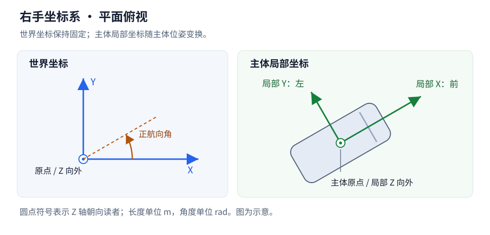

# 主体状态与道路关系

本文组织主体公开状态、运动能力及其与地图的关系。主体职责见[主体设计](README.md)，行为切换见[行为与控制](behavior.md)。

## 基础状态与运动能力

本节定义基础数据、坐标约定、主体参考点与分类控制接口。具体字段与执行参数按相应运动模型的能力定义。

### 公共状态

| 内容 | 含义与单位 | 数据关系 |
| --- | --- | --- |
| 身份与类别 | 运行身份、实体 ID、主体类别 | 身份保持稳定，类别与模型配置关联 |
| 位姿 | 主体参考点的三维世界位置，单位 `m`；三维姿态，角度单位 `rad` | 平面原型使用 XYZ 位置与绕 Z 轴的航向 |
| 线速度 | 世界坐标系下的速度向量，单位 `m/s` | 速率和主体纵向速度从该向量派生 |
| 加速度 | 实际运动的加速度向量，单位 `m/s²` | 标明采样时刻或估计区间，与请求控制量分别表达 |
| 角速度 | 三维角速度向量，单位 `rad/s` | 平面模型使用绕 Z 轴的分量 |
| 几何 | 局部轮廓、尺寸、高度及相对参考点的变换 | 世界轮廓由几何和实际位姿生成 |
| 生命周期与运动状态 | 在场、移除等生命周期，以及可运动、事故停驶等运行条件 | 运动状态与全局暂停状态分别表达 |
| 时间与版本 | Tick、状态版本及必要的区间标记 | 可在一批结果的共同元数据中保存 |

世界速度向量保留运动方向。速率表示其模长，纵向速度表示在主体朝向上的有符号分量。车辆倒车、侧向运动和行人朝向与移动方向的差异通过相应字段表达。

场景定义保存轮廓与运动参数等配置，主体查询提供完整基础状态包装对象。目标、路线、策略记忆和道路关系按各自职责通过显式查询取得。

初始状态可以提供速度；运行中的直接状态改写按显式编辑处理。动作给出的目标加速度、目标速度和实际运动结果分别保存，便于检查运动约束与执行偏差。

### 坐标与参考点

世界采用右手坐标系，Z 轴向上，平面航向以 X 正方向为零，朝 Y 正方向旋转为正。主体局部 X 轴向前、Y 轴向左、Z 轴向上。长度、时间和角度分别采用米、秒和弧度，角速度采用 `rad/s`。

主体原点统一采用轮廓几何中心的地面投影。车辆后轴等运动模型参考点由模型配置给出相对变换，轮廓和查询使用同一套主体位姿。位姿投影与道路关系查询明确使用的参考点。

公开状态、生成位置、Transform 和道路查询默认使用主体中心原点。后轴属于特定运动模型的内部计算参考点，调用方可以按需要显式选择相应位置。

外部数据导入和导出在接口边界完成坐标、旋转及单位转换。位置、速度、轮廓与姿态使用一致的变换约定。GUI 屏幕坐标由显示变换处理，内核与 Python API 保持统一的世界坐标。

平面原型采用 Z=0 和航向角。道路高程、俯仰与侧倾由对应的地图与运动能力提供。公共数据保持三维表达，具体姿态编码和高程跟随规则在高程模型中细化。

### 分类控制接口

| 主体或能力 | 基础输入 | 运动配置与专属状态 |
| --- | --- | --- |
| 机动车 | 纵向加速度与等效前轮转向角 | 轴距、转向及加速度约束，必要的转向执行状态 |
| 转向受约束的非机动车 | 与自身模型匹配的加速度与转向输入 | 轮廓、几何参数及速度、转向约束 |
| 行人或自由平面运动主体 | 目标速度向量，或平面加速度向量 | 速度与加速度约束，以及朝向更新规则 |
| 轨迹执行能力 | 带时间的位姿与必要运动字段 | 轨迹跟踪参数、偏差和实际生成的控制 |

输入采用有物理单位的量。目标速度由相应控制器转为运动输入，实际速度按运动模型与时间步更新。转向角、曲率和航向角速度具有各自含义，转换关系由具体运动模型定义。

机动车与非机动车的类别用于表达交通语义，运动能力由各自配置声明。行人的目标速度控制与加速度控制作为不同动作方式处理。轨迹与直接控制沿用完整控制组的解析规则。

油门、制动和档位等执行器输入可以随相应车辆模型引入。采用此类输入时，需要一并定义执行器到实际运动的关系。首轮优先验证加速度与转向输入，以及有界平面运动。

主体初始化时设置与其运动模型匹配的能力范围，包括速度、加减速、转向及适用的变向约束。参数在加载和创建时校验，具体值通过主体或车型配置给出。

模型参考点、参数、动作执行与数值推进的具体方案见[运动模型](motion.md)。

### Rust 类型组织

使用公共实体状态组合分类运动状态：公共部分表达身份、位姿、运动结果与几何引用；车辆转向执行状态等数据归相应运动模型管理。动作使用分类枚举表达输入形式，接收时检查主体能力、单位与执行区间。

主体状态、模型参数和动作类型各自维护清楚的字段。主体查询生成本地只读基础状态对象，具体数值类型与数组布局在内核和传输实现中确定。

## 道路关系与几何查询

### 关系分类

主体与路网的交互包括几何定位、占用判断、导航关联和交通规则查询。承载表面、连接、规则及规划工具的整体关系见[路网与空间模型](../network.md)。实际位姿与轮廓是几何计算的依据，目标和路线提供导航上下文。

| 关系 | 含义 | 结果 |
| --- | --- | --- |
| 几何投影 | 将主体参考点或任意位置投影到指定道路曲线 | 曲线身份、纵向位置、有符号横向偏移、切向与航向差 |
| 位置归属 | 判断参考点与车道、路面或区域的包含关系 | 零个、一个或多个候选，以及匹配依据 |
| 轮廓占用 | 判断主体完整轮廓与通行区域的空间关系 | 所占车道或区域、越界情况及相关几何结果 |
| 拓扑与规则 | 查询邻接、连接、通行类别与信号关联 | 所需路径或规则数据及其适用条件 |

换道时主体轮廓可以同时占用多条车道。路口可以存在多个合理的几何候选。道路外位置可以返回空归属，同时保留搜索范围内的邻近投影结果。最近曲线、位置归属和导航选择分别返回各自的含义。

投影需要明确主体参考点、目标曲线、纵向坐标原点和横向正方向。道路参考线纵坐标与车道中心线弧长分别定义，结果携带相应参考曲线身份与方向。

候选筛选需要考虑空间距离、高程和查询范围。朝向与路线可以参与导航匹配，逆行等实际状态仍保留相应的几何关系。违反通行规则按规则查询产生结果。

### 查询输入与范围

主体关系查询默认使用主体原点，允许显式选择模型提供的后轴等参考点。轮廓占用查询使用完整几何。任意位置查询提供世界位置，航向与轮廓作为相应查询的可选输入。

| 查询 | 输入范围 | 返回含义 |
| --- | --- | --- |
| 指定参考曲线投影 | 道路或车道参考曲线、查询位置 | 在明确曲线上计算纵向位置与横向关系 |
| 邻近候选查询 | 世界位置、搜索距离、对象类别与结果数量上限 | 返回搜索范围内的参考曲线及几何关系 |
| 位置归属查询 | 参考点、车道或通行区域的筛选条件 | 返回实际包含该点的车道与区域 |
| 轮廓占用查询 | 主体或世界轮廓、候选通行区域 | 返回轮廓实际重叠或接触的车道与区域 |

搜索距离和结果数量采用显式参数或有记录的查询默认值。返回结果标明实际搜索范围及是否因数量上限截断。无匹配属于正常结果，失效的地图引用、非法范围和所请求能力未受支持按错误处理。

几何候选按距离及稳定身份确定展示顺序，Agent 自行选择导航参考。结果边界允许多个包含候选，跨车道轮廓返回多个占用关系。道路外对象保持空归属，邻近查询仍可返回范围内的曲线。

### 纵横向坐标与结果

| 字段 | 约定 |
| --- | --- |
| 参考身份 | 地图版本、道路或车道身份、参考曲线类型及其方向 |
| `road_s`、`road_t` | 源道路参考线坐标，纵向从该道路参考线起点计算，横向以参考线左侧为正 |
| `lane_s` | 从选定车道中心参考曲线起点，沿该曲线方向计算的平面弧长 |
| `lateral_offset` | 相对选定参考曲线的有符号横向距离，曲线方向左侧为正，单位 `m` |
| `heading_error` | 主体航向减去参考曲线切向角，归一化到 `[-π, π)`，单位 `rad` |
| 几何结果 | 投影位置、切向、实际距离及是否位于曲线端点 |
| 归属与占用 | 参考点包含关系、轮廓关系与需要的越界诊断 |

车道中心参考曲线可以与道路参考线具有不同的方向和长度，二者的纵向坐标分别计算。双向通行区域使用明确选定的参考曲线方向，允许的通行方向通过规则表达。

投影限于参考曲线的有效区间，最近点在端点时明确标记。横向偏移和到曲线的实际距离分别返回，端点之外的位置继续保留自己的世界位置。

返回的道路与车道身份在对应地图版本内有效，源道路、车道段和车道标识另行提供以便追溯。道路查询与主体状态使用同一世界版本，查询过程保持只读。

### 计算、缓存与运行状态

几何关系由地图和实体位姿计算。地图维护可复用的空间索引；主体移动时，可以利用上次候选及其拓扑邻域缩小搜索范围，再按查询范围补充候选。具体索引和投影算法按地图精度与规模选择。

常用关系可以缓存到相应状态版本，供多个策略、GUI 和 Python 查询复用。缓存记录实体状态版本、地图版本及计算规则。位姿编辑、地图变化或版本不匹配使缓存失效，读取前重新计算有效结果。

导航匹配可以保留上次参考路径、路线进度和候选选择历史，以表达连续的导航状态。影响后续决策的匹配历史随检查点保存；纯几何查询缓存可以重建。匹配结果应表达歧义与匹配丢失等正常状态。

道路关联的更新保持主体实际位姿。自动吸附和位置调整不属于几何定位操作。

### 寻路工具与 Agent 导航

路网模块提供几何、拓扑、通行条件及基础寻路算法，按照调用方给定的起终点、约束和代价返回参考路线。路网寻路与空间路径规划面向各类主体开放，具体边界见[规划工具与 Agent 决策](../network.md#规划工具与-agent-决策)。几何查询结果保持对实际空间关系的描述。

Agent 的导航与行为策略决定使用哪些工具、选择哪个车道或区域、何时重新寻路，以及怎样响应偏离路线的情况。参考路线作为决策输入，实际运动由 Agent 的动作及运动模型产生。

错过路口、意外走错路、继续原方向或主动重新规划，均可以由不同策略表达。平台保留实际位置、占用与规则判断，导航工具的返回结果不直接改写主体运动。

导航匹配与路线进度属于 Agent 的运行状态，相应策略可以组合路线、几何候选与历史。首轮参考策略的具体选择在行为模型中定义，平台接口保持通用能力边界。

Agent 策略可以作为 Rust 内核中的普通实现运行，也可以通过 Python 接口提供动作。策略属于可替换的行为逻辑，路网算法属于可复用工具，两者在内核中按职责组织。
