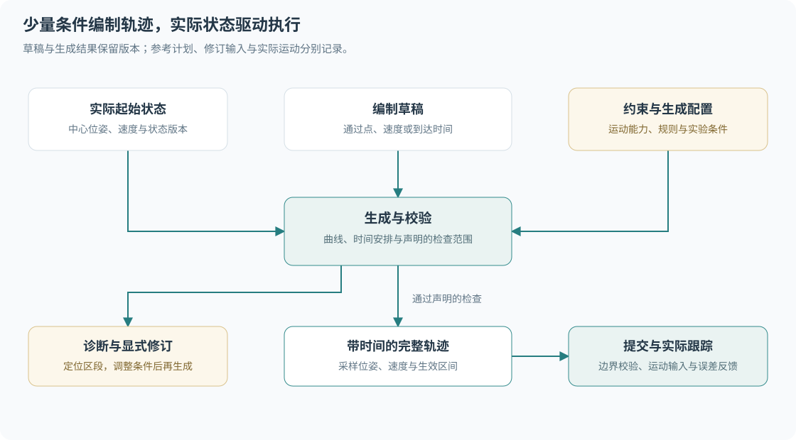
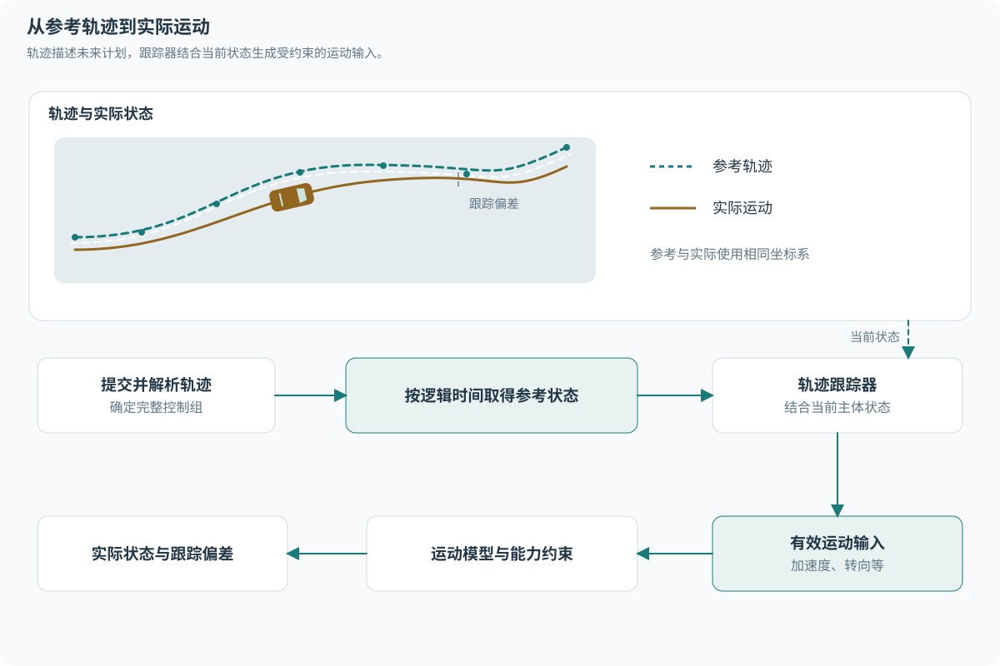

# 轨迹编制与执行

轨迹是一段参考运动计划，可由 Agent、Python 研究程序或 GUI 工具编制，并作为干预命令提交。编制工具将少量空间与时间条件转换成带时间的采样轨迹，执行器根据实际状态跟踪计划。主体的实际运动与接触事实由[运动模型](motion.md)维护。

## 职责与输入层次

| 内容 | 职责 |
| --- | --- |
| 目标与参考路线 | 表达导航意图，供 Agent 选择和生成行为 |
| 编制草稿 | 保存通过点、几何条件、速度或时间要求及编辑约束 |
| 轨迹生成结果 | 提供带时间采样、校验范围、诊断与生成依据 |
| 轨迹干预命令 | 指定主体、起始状态版本、生效区间及待执行的完整计划 |
| 执行反馈 | 保存实际输入、运动结果、约束原因和跟踪偏差 |

编制草稿归工具或研究程序管理。GUI 和 Python 可复用相同的生成与校验能力，界面交互保留在应用层。内核接收完整轨迹，沿用统一命令与运动执行边界。



## 编制草稿

草稿关联主体、运行、地图版本与起始状态版本。起点采用主体实际中心位姿、速度及所需模型状态，起始相对时间为零。手动编辑首先在暂停状态进行。

空间编辑点默认表示路径需要经过的位置，可附加明确的航向条件。GUI 在路径上新增点并拖动位置，生成工具重新计算受影响的曲线。Bezier 控制柄等曲线内部参数属于相应编辑工具，按具体算法另行提供。

| 编制方式 | 用户主要提供 | 工具负责生成 |
| --- | --- | --- |
| 路径与速度条件 | 通过点、目标速率及必要的局部速度条件 | 平滑路径、速度变化和相对时间 |
| 指定到达时间 | 通过点及需要明确到达的相对时刻 | 满足时间条件的候选运动与可行性诊断 |
| 导入轨迹 | 已有带时间位姿或可转换的研究结果 | 坐标与单位转换、结构及执行条件校验 |

默认编辑方式采用路径与速度条件。指定到达时间用于事件同步与实验复原，明确的到达时刻作为需要满足的条件。目标速度作为偏好时允许按声明的能力调整；指定的精确速度作为必须满足的条件时需要显式标记。生成请求记录这些条件的性质，冲突条件返回具体诊断。

终点位置、终点速度和结束后的行为分别表达。停车任务包含减速计划与相应的后续行为。模型能力与限值来自主体配置，编制工具读取这些能力形成约束。

## 轨迹生成与校验

生成过程从起始状态和草稿得到空间曲线，为曲线安排时间与运动状态，检查主体能力并生成采样。几何与时间条件共同决定可行性；调整通过点可能同时影响多个区段。

生成器声明所采用的曲线方法、时间参数化、采样精度和支持的约束。首轮选择一种明确的生成方法，具体算法通过案例验证后确定。生成失败返回诊断，用户可以调整路径、速度或时间后重新生成。

输出携带起始状态版本、输入条件、生成配置、已检查的约束范围和参考轨迹。生成器正在计算、约束检查失败或所需能力未受支持时，界面保留草稿与原因，提交入口保持不可用。

重新安排时间、降低目标速度或移动通过点作为显式修订操作。修订结果先预览，再由调用方确认提交。原始要求与采用的修订结果分别保留。

## 硬约束、软约束与风险

| 类别 | 示例 | 处理方式 |
| --- | --- | --- |
| 数据与状态有效性 | 时间顺序、有限数值、主体身份、起始连续性 | 必须满足，错误定位到字段或区段 |
| 运动能力硬约束 | 最大速度、加减速度、转向角及转向变化率 | 生成与执行分别检查，明确不可行的计划拒绝提交 |
| 实验中明确指定的条件 | 到达时刻、固定通过点或终点条件 | 在声明容差内满足，冲突时报告失败 |
| 规则与行为软约束 | 正常通行方向、车道偏好、舒适性与路线偏离 | 按配置形成代价或警告，由调用方决定修订 |
| 交通规则的严格规划条件 | 研究配置要求遵守的通行规则 | 作为本次规划必须满足的条件，保留配置依据 |
| 空间与交互风险 | 轮廓净空、预测接触、其他主体运动 | 报告具体风险和预测范围，实际接触遵循运动模型 |

硬约束与软约束属于生成请求的明确配置。运动能力是执行边界，交通规则用于表达规划条件与行为选择。各类主体共享物理空间，生成器按轮廓、表面和能力进行检查。主体类别本身不把运动限制在车道内。

事故研究可以主动构造接触风险。预测到接触的候选保留风险标记，实际运动执行完整轮廓与接触模型。未来多主体行为变化通过仿真产生，静态或有限预测范围的检查结果需要注明条件。

例如主体当前速率为 `10 m/s`、最大减速度为 `4 m/s²`，要求在 `0.5 s` 后停止会违反减速能力。诊断应指出对应时间段与所需减速度，提供延长时间等可供选择的修订方向。

## 干预、响应与跟踪误差

默认行为模型可以逐 Tick 产生动作，完整的未来轨迹属于可选输出。工具可以从当前实际状态直接编制干预轨迹，也可以把已有预测计划复制成草稿，并保留其来源与状态版本。

轨迹干预在确认的逻辑边界临时接管运动控制，到期或取消后，默认模型基于当时实际状态继续决策。新的完整轨迹可以替换旧计划的剩余区间，生效前重新校验起始状态。

主体根据实际状态、运动能力及声明的执行策略产生动作。跟踪误差通过实际运动与参考计划的差异表达。允许局部响应的 Agent 策略可以读取参考计划、观测与记忆，生成修订后的动作或轨迹；修订的来源、时刻和依据随记录保存。

基础轨迹跟踪器负责把计划转换为所选运动模型的控制输入。交通决策、避让与重新规划由明确配置的 Agent 策略承担。原始参考计划、采用的修订输入与实际运动分别保留，便于分析干预效果和偏差来源。

GUI 的新增点、拖拽与约束提示见[轨迹编辑交互](../../../crates/movara-app/docs/trajectory-editor.md)。

## 轨迹接口与执行

### 轨迹数据

轨迹表达主体在一段未来时间内的参考运动计划，由 Agent 策略、Python 或 GUI 的相应工具生成。轨迹作用于主体中心原点，采用统一的世界坐标与物理单位。

| 内容 | 约定 |
| --- | --- |
| 目标与身份 | 运行身份、主体身份、轨迹身份及版本 |
| 生效区间 | 开始和结束的 Tick 边界，沿用临时接管的起点包含、终点排除规则 |
| 采样时间 | 相对生效起点的秒数，首点为零，其后严格递增 |
| 采样位姿 | 主体中心的 Transform，平面原型包含位置与航向 |
| 目标速度 | 可选，采用主体有符号纵向速度或相应模型支持的速率语义 |

轨迹至少包含两个采样点，覆盖整个生效区间。首末时刻与区间边界对齐，中间采样允许采用不同间隔。缺省目标速度从相邻位姿与时间关系推导，推导需要遵循主体运动能力和参考点定义；存在歧义时要求调用方明确给出。

轨迹首点与实际开始状态进行一致性检查，位置、航向与需要的运动量采用有记录的容差。提交未来轨迹时先校验结构，在实际生效边界再次校验起始状态。明显不一致返回错误，并保留此前有效输入。

车辆倒车通过明确的有符号速度与车身航向表达。行人轨迹的运动方向由位置与时间关系给出，实际朝向沿用所选运动模型的规则。额外姿态能力按模型定义处理。

### 参考插值与跟踪

首轮采用简单、明确的参考插值：位置和显式目标速度分段线性插值，平面航向按相邻点的最短角差连续插值。采样点间的参考变化与实际运动分别记录，运动模型保证实际执行的连续性与能力约束。

轨迹跟踪器根据当前主体状态、参考计划、模型参数及自身运行状态生成控制量。机动车产生加速度与目标转向角，行人产生对应平面运动输入。主体中心与模型参考点的变换由执行器内部处理。

首轮跟踪器按 Tick 更新，在每个执行区间产生一组有效控制，转向等执行状态继续按数值子步推进。插值与跟踪的具体实现、参数和误差范围通过数值与场景案例确定。

轨迹跟踪使用自身执行状态和提交的计划。交通决策、避让、路径选择与重新规划由 Agent 策略承担。需要额外干预的控制器具有明确身份、输入和记录。



<details>
<summary>图示源码（Mermaid）</summary>

```text
flowchart LR
    PLAN[Agent 或外部提交轨迹] --> SELECT[解析完整控制组]
    SELECT --> REFERENCE[按逻辑时间取得参考状态]
    REFERENCE --> FOLLOW[轨迹跟踪器]
    ACTUAL[当前主体状态] --> FOLLOW
    FOLLOW --> INPUT[有效运动输入]
    INPUT --> MODEL[运动模型与能力约束]
    MODEL --> RESULT[实际状态与跟踪偏差]
```

</details>

### 校验与反馈

轨迹校验覆盖身份、时间顺序、有限数值、坐标约定、起始连续性及可明确检查的运动能力条件。明显超出能力的输入返回具体错误。未来多主体交互的结果通过实际仿真产生，接受轨迹不构成无接触或精确跟踪的保证。

曲率、目标速度和采样密度需要与模型相适配，具体可行性检查按跟踪器支持范围声明。跟踪器生成范围内的有效输入，实际偏差和约束原因进入反馈。内部计算失败触发运行错误。

查询和记录提供轨迹身份、参考时刻、参考与实际位姿、速度误差、位置与航向误差、实际输入及约束诊断。偏差超过配置阈值时产生诊断事件，是否重新规划或暂停由 Agent 或事件处理方决定。

### 更新、到期与交还控制

滚动更新提交新的完整轨迹，在确认的边界替换旧轨迹的剩余部分。新计划从该边界的实际状态开始校验，被替换轨迹保留实际执行区间和结束原因。

轨迹覆盖对应的完整运动控制组。同一窗口中的轨迹与直接控制按共享控制规则解析；切换动作方式需要完整输入。新轨迹生效前，原有效输入继续按自身区间执行。

到期或显式取消时，轨迹结束临时接管，默认行为模型基于当前实际状态接回控制。终点位置与速度保持计划含义。实际状态不会在到期时被改写为轨迹终点，也不会隐式延长最后一个控制值。

任务需要停车时，应提交满足运动能力的减速计划，并配置相应的后续停车行为。计划结束后的持续运动或停止由当前行为模型决定。事故停驶状态继续遵循事故模型的约束。
