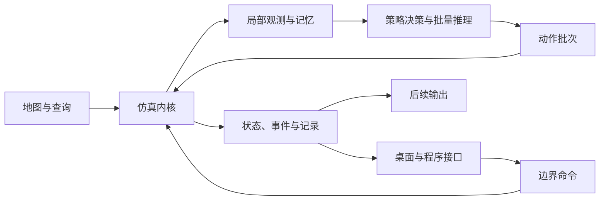

# 核心设计

本文描述 Movara 内核的模块职责、世界模型、执行语义和程序接口。内容属于设计方案，具体数据字段、接口名称和构建单元在工程验证中确定。交付状态见[路线图](../ROADMAP.md)。

## 系统结构

内核维护唯一的世界状态和逻辑时间，负责地图查询、主体生命周期、观测生成、策略调度、运动、接触和记录。桌面、CLI、Python 与后续输出通过调用接口和只读数据访问内核。

发布应用将内核集成在进程内，由启动模式选择 GUI 或 headless 运行。代码模块的划分独立于可执行文件数量，内核库保持独立构建和测试。应用入口见[应用与启动模式](gui.md#应用与启动模式)。

| 组成部分 | 职责 | 主要数据 |
| --- | --- | --- |
| 地图 | 导入道路、建立几何与拓扑查询 | 道路、车道、区域、连接、信号关联和派生索引 |
| 世界 | 维护主体与环境的当前状态 | 实体身份、位姿、运动、轮廓、信号和生命周期 |
| 信息系统 | 生成局部感知、通信消息和历史估计 | 观测、在途消息、来源、时间与记忆 |
| 策略系统 | 调度规则、脚本与模型决策 | 策略配置、共享权重、主体记忆和动作批次 |
| 运动与接触 | 执行动作、推进位姿并检测接触 | 控制、轨迹、运动区间、接触与事故状态 |
| 运行协调 | 应用命令并组织逻辑步 | 场景、命令队列、时间、控制来源和阶段顺序 |
| 记录与恢复 | 保存实际过程并建立恢复点 | 命令、动作、状态、事件、快照和检查点 |

这些组成部分表示逻辑职责。代码包、crate 和线程划分按实际依赖与构建成本确定。

## 世界与数据模型

### 状态所有权

世界状态由运行协调者统一提交。地图和当前阶段的观测提供只读访问，每个 Agent 独占运行记忆与随机状态。模型权重可以共享。

桌面显示、统计与导出数据由世界状态或运行记录派生。派生数据应保留对应的状态版本或 Tick。外部读取和显示操作不得修改世界状态。

| 数据类别 | 内容 |
| --- | --- |
| 导入地图 | 源文件身份、版本、单位、道路几何与连接 |
| 地图派生数据 | 采样曲线、空间索引与绘图数据，可从地图重建 |
| 场景配置 | 地图引用、初始主体、路线、策略参数、种子与事件 |
| 世界状态 | 实体位姿、运动、轮廓、道路关联、信号和生命周期 |
| 策略运行状态 | 历史、隐藏状态、持续动作、决策计时与随机状态 |
| 运行数据 | 实际命令、动作、状态、事件和完整检查点 |

实体 ID 在同次运行中保持稳定且不复用。策略切换保留实体身份，分支运行另有运行身份。

### 坐标与道路关联

世界采用米制 XYZ 坐标，初始平面场景取 Z=0。坐标轴方向、角度单位和接口转换规则需要在数据接口中明确。

对象的实际位姿和轮廓构成几何查询依据。车道关联、路线与路径弧长用于导航和进度描述。车道归属允许缺失或存在多个候选。

道路高程和空间层次需要独立的几何支持。立交接触判断必须考虑高度关系。二维画面的重叠不能直接判定为接触。

## 地图与交通组织

OpenDRIVE 导入包括结构读取、曲线求值、车道宽度与偏移、道路和路口连接、信号关联。源文件版本与支持子集作为地图能力的一部分记录。技术候选见[开发指南](../development.md#依赖选择)。

运行时地图提供车道中心与边界、方向、连接、通行类别和空间查询。行人及非机动车使用相应的通行网络与区域。场景可以补充过街区、等待区和共享空间，补充内容保持与源地图的关联。

交通需求采用入口生成规则和指定路线。需求到达与主体实际插入分别记录，入口积压保持显式状态。主体进入、离开和清除均产生生命周期事件。

## 行为与运动

### 分层动作

行为接口区分目标与导航、行为决策、短时轨迹和运动控制。不同主体和策略可以接入所需层次。

| 层次 | 语义 |
| --- | --- |
| 目标与路线 | 目的地、路线或行为意图，由导航或规划转为运动计划 |
| 短时轨迹 | 带时间的未来运动计划，支持滚动更新 |
| 运动控制 | 车辆加速度、转向或曲率，以及行人速度或加速度等控制量 |
| 实际状态 | 运动执行后形成的位姿、速度和接触事实 |

每个主体在同一执行区间具有一个有效动作来源。人工、脚本和默认策略的优先关系由控制配置确定，来源链随实际动作记录。

轨迹执行器根据当前实际状态和运动约束执行计划，记录计划与执行结果的偏差。轨迹切换应与当前状态连续。未来轨迹表达策略对后续运动的计划。计划执行后的实际状态由内核运行产生。

### 连续运动与规则

车辆的位姿随时间连续变化，转向与换道通过运动模型执行。路径关联变化应保持物理状态连续。行人采用独立的导航和有界平面运动模型。

交通规则描述合法性，策略选择行为，运动执行检查数值与运动学有效性。偏离合法车道或过街区域的主体继续参与运动、观测与接触检测。

显式瞬时位置编辑作为场景操作记录。正常控制不得通过吸附、隐含传送或全知安全控制重写主体运动。额外安全控制应记录其身份、输入和实际干预。

### 空间查询与接触

接触检测分为候选筛选和精确轮廓查询。所有参与接触的动态主体、事故占道对象与静态障碍按类别纳入查询。候选筛选依据几何范围。

小场景可以使用包围圆或轴对齐包围盒筛选。包围圆应覆盖完整轮廓，矩形可采用中心到最远角点的距离。城市规模查询需要减少全对象两两比较，空间索引可评估网格、空间哈希、四叉树或包围体层次结构（BVH）。

包围体重叠表示需要进一步检查。精确接触依据实际形状确定。高速运动需要覆盖完整 Tick 区间，检查途中接触。仅检测区间端点可能遗漏穿越。

### 事故处置

接触事实、事故状态和全局运行控制分别维护。事故主体可以停止并占据空间，其他主体根据局部信息与策略停车、绕行或改道。任务配置可以选择暂停或终止。

处置方式包括等待、自行驶离、清除和拖离。拖离可以将拖车与故障车辆关联为一个运输组合体，以组合轮廓和运动配置驶离。事件记录保留原对象身份及组合关系。

该抽象描述交通占用与恢复。牵引机械过程、损伤程度和车身变形不属于模型范围。处置时长与可驾驶状态由配置或专门模型给出。

首次接触定位、停止规则和残余重叠处理仍需专门确定。接触事件应能区分持续接触与新的接触过程。

## Agent 信息与记忆

本节定义信息能力的长期设计。首轮原型采用明确标记的完整信息条件，策略通过独立输入接口接收数据。有限观测、通信与记忆在后续阶段实现。

### 能力组合

| 维度 | 配置内容 |
| --- | --- |
| 主体与运动 | 几何形状、运动能力与执行方式 |
| 行为策略 | 人类行为模型、自动驾驶策略、规则或脚本 |
| 本地感知 | 视域、距离、遮挡、类别、采样周期和误差 |
| 通信 | 自身状态广播、感知目标共享与路侧信息 |
| 记忆 | 历史观测、目标跟踪、外推、有效期和模型状态 |
| 控制 | 决策周期、反应延迟、输出层次与接管权限 |
| 风格 | 激进、正常、保守等行为参数 |

这些维度分别表达行为、信息和执行能力。信息覆盖范围、自动化程度与驾驶风格需要分别解释。

### 信息来源与时间

本地感知由世界状态通过几何过滤和误差模型生成。自身广播采用发送方的状态估计，目标共享采用发送方的感知结果。接收者将本地感知与已到达消息纳入自己的记忆。

消息和目标估计需要记录来源、观测或估计时刻、发送时刻、接收时刻、决策使用时刻、有效字段、质量与覆盖范围。未来意图由发送方明确发布。

世界实体身份、发送方局部目标身份和接收方跟踪身份分别表达。精确身份关联可用于明确标记的理想条件或评价。

完美自身定位、精确可见对象状态和精确数据关联可以作为初始简化，使用时应明确标记信息假设。交通灯、地图与远端规划意图也需要说明来源。

同一场景可以组合本地驾驶、自身状态网联、目标共享和完整信息对照等配置。只共享车辆的配置限制通信内容。接收者仍保留自己感知到的其他类别对象。路侧设备可以共享未配备通信设备的行人。

### 历史与不确定性

被遮挡或位于视域外的对象停止产生新的直接观测。历史对象可以根据已有证据外推，并保留信息年龄、来源和不确定性。隐藏对象的当前真值不得刷新历史记录。

多源重复与冲突需要明确融合规则。消息保留发送时的内容，接收后由记忆或策略外推。感知遮挡与无线通信覆盖分别建模。

初期通信采用对象列表、固定更新周期和配置延迟。理想通信可以作为对照。物理层、真实编码、安全协议、带宽竞争与复杂融合属于后续范围。

### 规划输入与显示

规划输入可以采用对象列表、矢量地图或局部 BEV 栅格，并明确坐标系。BEV 栅格需要定义范围、分辨率、语义通道与未知区域。

| 表示 | 内容与用途 |
| --- | --- |
| 世界状态 | 实际对象、道路和运动，用于仿真与评价 |
| Agent 信息 | 允许的本地观测、已到达消息与历史估计 |
| 规划输入 | 从 Agent 信息派生的对象、矢量或栅格表示 |
| GUI 画面 | 世界或选定 Agent 信息的可视化 |

局部规划输入从允许信息生成。未覆盖区域标记为未知，历史估计保留年龄。GUI 显示范围和绘图样式保持独立。

基本决策直接处理结构化信息。相机与视觉感知模型属于独立研究或输出能力，几何输入下的行为结果仅适用于相应信息假设。

## 时间与执行

### 逻辑时间

Tick 表示逻辑步编号，固定步长为 `dt`，边界时刻为 `t_k = k × dt`。一次同步 `step` 从边界 `t_k` 推进到 `t_(k+1)`。

策略决策、显示、消息与传感器可以具有不同频率，各自保留与逻辑时间的对应关系。同一世界由唯一推进者控制。暂停支持检查和编辑，单步采用相同执行语义。

### Tick 阶段

以下顺序构成执行流程草案，具体边界细节通过原型验证。

1. 验证并应用当前边界生效的命令。
2. 接收已到达消息，更新观测与局部记忆。
3. 固定本阶段策略输入，执行并行决策或模型批量推理。
4. 收集动作与记忆更新，确定有效控制来源。
5. 推进运动，检查区间接触与条件事件。
6. 提交下一状态，记录实际命令、动作与事件。
7. 发布带状态版本的只读快照。

同一逻辑时刻的边界编辑可以产生不同状态版本，记录需能区分。各策略读取同一阶段的信息，策略遍历顺序不得引入其他主体的未来状态。

策略决策周期可以长于 Tick。未到更新时刻的主体按动作定义持续执行已有控制或轨迹。

定时命令在目标边界生效。区间内发现的事件保留所属区间和可取得的事件时间。影响后续动作的条件事件安排到后续可执行边界。中间时刻命令采用明确的离散化规则或返回错误。

信号更新使用明确的生效时刻。已发布的过去记录保持不变。

### 并行与随机性

决策阶段采用只读输入和主体私有记忆。共享模型按 Agent ID 组织批次，输出校验身份与完整性，动作全部收集后统一推进世界。

随机流按稳定的主体身份组织，外生扰动还需明确与逻辑时刻的对应关系。采样结果不得依赖线程分配、遍历顺序或完成顺序。

并行策略可能给出相互冲突的动作，其实际后果由运动和接触阶段处理。多轮协商策略需要显式定义信息轮次。

研究区、缓冲区和外围可以显式分配不同成本的策略。自动切换需要定义记忆初始化、历史保留和边界事件，并考虑路线与交互影响。

## 命令与控制

编辑生成草稿，提交验证一组修改并安排生效时刻，`step` 推进世界。提交可以保持当前逻辑时间。

一组修改应整体接收。任何无效修改均使该组失败。命令包含目标 Tick、来源与确定顺序，冲突采用公开的拒绝或排序规则处理。运行错误明确返回。

界面、Python 和脚本采用相同命令语义。界面操作还应记录实际接受与生效 Tick，以便重跑。

策略切换保留实体身份与连续状态，并按目标策略的要求初始化记忆和控制。接管、释放、动作来源和切换时刻均写入记录。

交互式场景录制可以包含正常运行、选择主体、临时接管、执行异常动作和保存过程。强制动作样本标记干预来源。

## 记录、恢复与分支

| 数据 | 用途 | 覆盖范围 |
| --- | --- | --- |
| 场景配置 | 定义可重复的初始条件 | 地图、主体、策略、参数、种子与事件 |
| 命令与动作记录 | 复查实际输入和控制 | 编辑、策略输出、接管、来源和时刻 |
| 状态与事件记录 | 分析实际运动与结果 | 位姿、速度、接触、违规和完成 |
| 展示快照 | 提供只读查询与显示 | 选定状态版本的公开数据 |
| 检查点 | 恢复完整运行上下文 | 世界、时间、队列、控制、策略记忆与随机状态 |

动作重放使用已记录输入。干预分支从共同历史出发重新计算相关主体的响应。固定其他主体轨迹属于回放条件，需要单独标记。

检查点包含等待时长、持续动作、目标路径和在途消息等影响未来的状态。外部策略需要声明恢复能力。缺少完整恢复支持时，可从共同初始条件重新运行。

展示快照、策略观测和检查点按各自用途生成。外部传感器与渲染后端需要独立声明恢复能力。

分支对照核对首次干预前的状态、观测和有效动作。同版本、同环境的重复性作为基础要求，外部模型的非确定性单独说明。

序列化格式按场景、日志和轨迹规模选择。内部格式变更采用直接迁移或明确失效。高成本资产可安排一次性迁移。

## Python 与其他程序接口

Python 通过内核绑定提供加载、重置、单步、命令、批量状态与观测、动作、记录和恢复。CLI 使用同一运行接口。桌面交互见[桌面界面设计](gui.md)。

| 接口领域 | 输入与输出 |
| --- | --- |
| 运行控制 | 场景与命令输入，返回状态版本和事件 |
| 策略调用 | 按 Agent ID 和 Tick 组织的观测与记忆，返回动作和更新记忆 |
| 批量推理 | 同模型观测批次输入，返回对应主体的动作批次 |
| 记录与恢复 | 输出运行数据，保存或加载受支持的检查点 |
| 学习任务 | 提供观测、动作、奖励、终止与时间预算截断 |

跨语言交互优先采用批量数据。内存所有权、数据复制和线程边界需要明确。训练与模型运行环境按研究需要单独配置。

风险、奖励和任务评价位于任务层。物理事实与任务终止分别记录。训练信息条件与评价条件需要明确区分。
