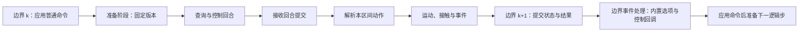

# 执行与记录

本文定义逻辑时间、共享控制、命令解析及仿真录制规则。GUI、headless 和 Python API 使用相同的执行语义，内核负责世界状态的有序推进。

## 逻辑时间与命令窗口

Tick 表示内核逻辑步编号，固定步长为 `dt`，边界时刻为 `t_k = k × dt`。一次同步 `step` 从边界 `t_k` 推进到 `t_(k+1)`。显示帧、策略决策和传感器采样可以采用不同频率，并保留与逻辑时间的对应关系。

秒表示物理时间、持续时长和轨迹采样时间，Tick 定位状态与命令边界。用户可以配置逻辑步长，`dt` 在同次运行中固定，频率为 `1 / dt`。逻辑频率不限定为 10 Hz 的倍数。

按秒指定时刻的边界操作转换到不早于请求时间的首个逻辑边界，同时保留请求时间、实际生效 Tick 与确认时间。已错过的显式时刻返回错误，交互请求可以采用下一个可用边界。区间接触等内部事件保留实际发生时刻。

持续时长以确认的开始边界为起点，结束时刻同样转换到不早于请求结束时间的首个边界。有效区间采用起点包含、终点排除的规则，正时长至少覆盖一个 Tick。调用方可以直接指定起止 Tick，时间区间与轨迹采样覆盖范围一起校验。

边界换算采用统一实现，浮点容差只用于识别边界计算的数值误差，具体容差通过数值验证确定。已确认的操作保存实际 Tick，重跑使用确认结果。

单位换算保持相同物理含义，改变逻辑步长会影响数值误差、决策频率和响应时机。不同时间步的结果按数值验证要求评价。

一个 Tick 可以接收并处理多条命令。命令的数量与推进次数分别计算。每个主体在进入运动阶段前形成一组有效控制，每个控制量使用一个确定值推进该区间。

命令声明目标运行、目标对象或系统、操作类型与请求生效时刻。应用为接收的命令分配递增序号，并记录来源。命令序号在同一运行中形成确定顺序。

脚本可以指定目标 Tick，交互操作可以请求下一个可用边界。应用返回解析后的目标时刻，最终结果记录实际生效 Tick 和状态版本。同一逻辑时刻的编辑可以产生不同状态版本。

进入执行阶段时固定普通输入。同步控制回合预留对应的提交入口，其返回用于完成当前回合。其他执行期间收到的命令安排到后续可用边界。显式指定已经错过的 Tick 时返回错误。请求“下一个可用边界”时，由调度器确定并返回实际目标。

一次阶段解析的待处理命令集合称为生效窗口。已执行的窗口保留其结果，后续修改进入新的窗口。暂停期间多次提交可以在同一 Tick 产生新的状态版本。

## 共享控制

GUI 和 Python API 都可以查询状态、控制运行和提交修改。连接应用后沿用共享控制规则，各入口具有相同的命令语义。

应用是同一世界的唯一运行协调者，负责命令排序、验证和执行。GUI 与 Python 的共享操作通过该协调入口进入内核。界面刷新、选择和平移缩放保持独立。

多个客户端连接沿用同一规则，命令保留对应连接来源与接收序号。主体分组可以用于外部策略分工，冲突仍按命令类型和顺序解析。连接订阅、回合身份与查询结果分别管理。

连续运行、暂停和单步是应用运行状态与操作。主体加速度、轨迹和属性属于世界或主体命令，两类命令分别处理。

## 同步控制回合

观察通知与同步控制订阅分别管理。观察通知用于数据访问，同步控制订阅构成逻辑步继续推进的条件。

Python API 在连接或启动应用时按连接模式建立对应订阅。读取控制帧或观察通知消费既有订阅，连接确认包含生效边界。

应用在约定的逻辑边界建立带运行身份、Tick 和状态版本的回合，生成预定义查询结果，再等待 Python 的批量提交。该回合期间，世界推进保持等待，动态查询读取相同状态版本。

所需参与方提交有效结果后，应用完成命令与动作解析，继续对应逻辑步。没有干预时显式提交空批次。必需提交不得被直接丢弃或以旧动作替代。

存在多个控制客户端时，应用记录当前回合需要的参与方，并分别确认提交。回合内的数据与状态版本保持一致，所有必需结果到齐后统一完成本步。普通观察连接继续采用非阻塞交付。

GUI 绘制和请求接收在等待期间保持响应。其他来源的修改按照命令窗口与阶段规则调度，已发布的回合数据保持不变。运行命令保持控制回合的等待条件。

同步与异步 Python API 采用同一回合协议。异步调用允许 Python 调度其他任务，内核继续保持同步推进。回合身份、查询版本、提交内容和处理结果用于验证与追溯。

## 查询与预先提交

预定义查询在应用侧登记，并随约定的通知或控制回合返回批量结果。动态查询补充特定回合或状态版本的信息。查询注册、修改和取消具有明确的生效边界与规则版本。

已知时刻的操作可以提前提交普通命令并指定目标 Tick。内核命令队列在相应边界处理这些命令，保留来源、顺序及实际执行结果。固定行为采用明确的场景选项，例如事故后暂停。

Python 自定义条件可以在逐 Tick 控制回合中判断，也可以按事件登记 Python 回调。Python 回调在调用方进程执行，应用仅在事件匹配时通知。定时命令、内置选项、Python 回调和逐 Tick 控制共享命令及记录语义，具体接口见[事件与回调](../python-api/events.md)。

### 边界事件处理

逻辑步提交后形成带版本的事件批次。应用先完成该批次对应的事件处理，再准备下一逻辑步。内置选项产生的命令按确定顺序进入边界窗口，匹配的外部控制回调取得固定版本的事件上下文，提交后再应用其命令。

事件控制回调期间，内核查询读取上下文对应的版本。回调返回的信号、路线或主体修改在下一逻辑步准备前处理，完成后生成新的版本。后续逐 Tick 控制回合读取更新后的版本。

事件控制回调可以独立于逐 Tick 控制订阅使用。观察回调按通知处理，推进保持非阻塞；控制回调需要有效确认后才能继续推进。连接同时具有事件控制与逐 Tick 订阅时，由同一个消息驱动器按顺序完成对应回合，两个阶段分别保留身份与提交义务。

多个控制回调基于各自确认的版本产生批量命令，冲突继续采用统一接收顺序。回调产生的派生事件进入后续逻辑边界的事件批次，避免在当前调用栈递归执行回调。暂停期间的事件交付与显式处理方式在会话驱动接口中确定。

内置处理失败，以及必需外部事件控制的异常、断线和超时，触发运行故障停止。普通观察回调的错误明确交付相应连接，是否暂停世界通过显式控制请求决定。

## 命令分类

| 类型 | 示例 | 执行规则 |
| --- | --- | --- |
| 只读查询 | 状态、地图、观测和事件查询 | 返回已提交状态及其版本，各查询独立执行 |
| 显示操作 | 平移、缩放、选择和图层切换 | 作用于界面，保持仿真状态与时间不变 |
| 属性赋值 | 目标速度、信号参数和主体属性 | 不同字段合并，同一字段按覆盖规则确定值 |
| 运动动作 | 加速度、转向、速度向量和短时轨迹 | 解析为有效控制量或完整控制组，在对应区间执行 |
| 独立事件 | 信息发布、标记和可重复触发的场景事件 | 按命令语义逐条执行，保留各次事件身份 |
| 生命周期操作 | 主体生成、清除和策略切换 | 验证对象与关联条件，按明确顺序执行 |
| 系统命令 | 运行、暂停、单步、重置和加载场景 | 按运行状态与命令前置条件处理 |

命令类型规定可修改字段、关联控制组、重复调用语义和允许的运行状态。事件和生命周期操作根据自身语义判断，普通属性覆盖规则仅作用于可替换的赋值或控制。

## 主体命令解析

### 合并与覆盖

同一对象在同一生效窗口可以接收多条命令。彼此独立的字段可以合并，冲突字段默认采用接收序号最大的有效命令。

加速度与转向等独立控制量可以分别指定。具有强关联的参数由命令类型定义为完整控制组，例如轨迹执行与直接运动控制是互斥的动作方式，解析时保留一组一致的执行输入。

无效命令返回错误并退出候选集合。此前有效命令保持有效。基础行为模型与外部策略如何产生候选动作，由策略接口定义；进入命令解析后保留其明确的来源与顺序。

例如，在 Tick 40 的命令窗口中：

| 接收序号 | 来源 | 对象 | 内容 | 解析结果 |
| --- | --- | --- | --- | --- |
| 201 | Python | 车辆 A | 加速度设为 `1 m/s²` | 被后续加速度命令覆盖 |
| 202 | GUI | 车辆 A | 修改显示颜色 | 独立生效 |
| 203 | GUI | 车辆 A | 加速度设为 `-2 m/s²` | 作为该区间的最终加速度 |
| 204 | Python | 车辆 B | 加速度设为 `0 m/s²` | 对车辆 B 独立生效 |

车辆 A 使用最终解析值推进一次逻辑步。修改颜色与覆盖加速度分别记录。

### 批量与完整性

普通批量请求按各命令的语义处理。需要原子接收的修改组显式声明原子性，整组通过验证后接收，任一无效修改使该组失败。接收后的命令仍参与该生效窗口的解析。

关联字段的不可分割性由控制组定义。独立字段的后续赋值遵循覆盖规则。解析结果在进入运动阶段前完成校验，运动积分使用确定后的控制输入。

### 处理结果与诊断

| 结果 | 含义 | 反馈 |
| --- | --- | --- |
| 生效 | 命令按其语义执行 | 返回实际时刻、状态版本及必要结果 |
| 合并 | 独立字段与其他命令共同生效 | 记录各字段及来源 |
| 覆盖 | 可替换的值被后续有效命令替代 | 返回覆盖关系和最终来源 |
| 无变化 | 幂等操作的目标状态已满足 | 返回无变化说明 |
| 警告 | 操作有效，存在需要注意的条件 | 保留执行结果，另附诊断 |
| 失败 | 输入、对象或运行状态不符合要求 | 返回具体错误，保持受影响操作的状态一致性 |

普通覆盖是共享控制的正常结果，记录覆盖关系即可。命令类型可以对特定条件产生警告。参数无效、对象不存在和禁止的状态转换按错误处理。

默认解析采用接收顺序。按来源优先或拒绝冲突的策略可以作为显式配置扩展，规则身份与配置随运行记录保存。相同输入和规则应能重现相同的解析结果。

## 请求、结果与领域事件

请求身份用于关联一次调用，命令身份用于追溯批次中的具体操作，运行身份用于校验目标上下文。应用为接收的命令分配来源与接收序号，调用方提供的身份需要经过相应校验。

| 数据 | 主要内容 | 含义 |
| --- | --- | --- |
| 接收回执 | 请求与命令身份、接收序号、确认的目标边界 | 请求已经登记，等待对应窗口处理 |
| 执行结果 | 命令身份、结果类别、实际 Tick 与版本、返回数据及诊断 | 说明生效、覆盖或失败等处理事实 |
| 运动反馈 | 主体、控制组、执行区间、请求与有效输入、实际状态及约束 | 说明动作如何执行 |
| 领域事件 | 事件身份、类型、运行、Tick 或区间时刻、参与对象及关联命令 | 说明世界或运行中发生的事实 |

创建成功的执行结果返回实体身份。接收回执只确认已登记的请求，调用方在取得创建结果后使用该实体。批量创建可以一次返回多个身份，再批量提交相应后续操作。

事件类型包括主体进入与移除、接触开始与结束、事故停驶与清除、规则违反和运行故障。事件可以关联产生它的命令，运动与环境演化也可以直接产生事件。运行内事件具有稳定身份和明确顺序，连续接触的各阶段关联同一次接触过程。

定时命令描述未来的操作，领域事件描述已经发生的事实。内置选项与回调产生的命令保留触发来源，按统一边界执行，再产生相应结果和事实。领域事件的查询保持只读。

在边界 `k` 发布的控制回合读取固定版本，提交的动作作用于 `[t_k, t_(k+1))`，完成后产生边界 `k+1` 的状态。区间内事件保留自己的发生时刻。控制提交携带的普通世界修改进入后续普通命令窗口，暂停等系统操作继续遵循已定义的边界约束。

暂停时的普通修改可保持 Tick 并产生新的状态版本。控制回合数据始终对应其固定版本，所需修改结果通过实际生效 Tick 和版本辨识。

## 系统运行命令

系统命令由应用有序执行，并检查相应的运行状态。它们描述运行操作，执行语义独立于主体字段的覆盖规则。

| 命令 | 允许条件 | 语义 |
| --- | --- | --- |
| 运行 | 场景就绪、运行未失败且未执行重置或加载 | 从逻辑步边界进入连续推进；已运行时返回无变化，控制回合仍等待提交 |
| 暂停 | 场景就绪 | 在逻辑步边界停止后续自动推进；已暂停时返回无变化 |
| 单步 | 暂停、运行未失败且场景就绪 | 按请求推进指定步数，完成后保持暂停 |
| 重置 | 暂停或故障停止，且具备可重建场景 | 重建初始条件，建立新的运行身份与时间起点 |
| 加载场景 | 暂停、故障停止或尚未加载场景 | 验证并加载新场景，成功后建立新的运行上下文 |

连续运行期间的单步请求明确报错，调用方可以先请求暂停。两个有效的单步请求按序分别执行，各自返回推进前后的 Tick。

多个系统命令按序验证其前置条件。运行状态已经变化时，后续命令依据变化后的状态处理。

重置和重新加载会使旧运行上下文的待执行命令失效，失效原因与受影响命令保留在结果中。新运行身份用于区分同名对象与重新开始的 Tick。

### 控制失败

应用收到 Python 的控制回合失败报告、发现控制连接断开或等待提交超时后，停止该次仿真并标记失败。记录保留最后状态、未完成回合、错误原因及相关输入。

失败报告与提交均关联运行及回合身份。旧运行的消息明确返回失效结果，后续新运行保持其独立状态。

故障停止与人工暂停分别表达。故障运行拒绝继续推进，后续操作必须显式发起。应用界面与查询可以继续用于诊断，重置或加载场景后建立新的运行上下文。

普通观察连接的断开只结束相应连接。同步控制订阅承担必需提交义务，其丢失会导致该次仿真失败。

## Tick 执行阶段

1. 验证并应用当前边界的系统与世界命令，解析属性修改和运行条件。
2. 接收已到达消息，更新观测与主体记忆。
3. 固定本阶段输入与状态版本，按订阅生成查询结果和控制回合，执行策略调用并等待必需提交。
4. 收集候选动作与记忆更新，按命令规则形成最终控制输入。
5. 推进运动，检查区间接触与条件事件。
6. 提交下一状态，记录实际命令、动作和事件。
7. 发布带逻辑时刻与状态版本的只读数据。

本步产生的事件在下一步准备前进入边界事件处理，执行已配置的内置行为并等待必需事件控制。运行请求的暂停与终止结果共同约束后续调度。

信号更新使用明确的生效时刻。区间内发现的事件保存所属区间和可取得的事件时间，影响后续动作的条件事件安排到后续可执行边界。已发布历史保持不变。

策略更新周期可以长于 Tick，期间按动作定义持续已有控制或轨迹。暂停时的配置编辑保持逻辑时间，修改以状态版本区分。

### 并行与随机性

策略读取同一阶段的信息，每个主体独占其运行记忆。共享模型按 Agent ID 组织批次，输出校验身份与完整性。采样采用稳定的主体和逻辑时间关联，结果独立于线程分配与完成顺序。

策略遍历顺序不得引入其他主体的未来状态。不同主体的动作可以产生交互冲突，其实际后果由运动与接触阶段计算。多轮协商需要显式定义信息轮次。

研究区、缓冲区与外围可以分配不同成本的策略。自动切换需要定义记忆初始化、历史保留与边界事件，并考虑路线和交互影响。

## 仿真录制

仿真录制保存初始条件、实际输入、命令处理过程和运行结果，使 GUI 与 Python 的混合操作可追溯。

| 记录类别 | 内容 |
| --- | --- |
| 运行条件 | 场景、地图身份、配置、版本、模型身份、随机种子和解析规则 |
| 输入记录 | 命令内容、来源、接收序号、目标运行、请求时刻和实际生效时刻 |
| 处理记录 | 验证、合并、覆盖、无变化、警告与失败，以及关联命令身份 |
| 注册与回合 | 查询和事件订阅、过滤条件、生效与取消时刻、控制回合及提交 |
| 动作记录 | 原始策略输出、最终执行动作、控制约束处理和执行区间 |
| 状态与事件 | 主体运动、信号、接触、违规、消息、切换、处置和恢复等实际过程 |
| 检查点 | 世界、时间、队列、订阅注册、持续动作、策略记忆、等待状态和随机状态 |

影响仿真的 GUI 操作转换为语义命令记录。镜头、选择和面板等显示操作可以采用独立的界面记录，用于重现观看过程。

定时命令与内置行为的实际执行、事件回调的触发、动态查询使用的状态版本和控制回合失败原因随运行记录保存。外部策略恢复需要声明其内部状态与未完成回合的恢复能力。

从运行中途开始录制时，应保存能够解释后续过程的起始状态。支持从该点重新仿真的录制还需要完整恢复上下文。外部策略、传感器和渲染器分别声明恢复能力。

录制文件格式、采样频率和存储方式根据用途与规模选择。记录能力与完整录制界面、时间轴编辑器分别交付。

## 回放与实验分支

结果回放读取已记录的状态与事件，展示实际发生的过程。动作重放从相应初始条件或检查点运行已记录输入，核对产生的状态与事件。

重新仿真保存并使用已解析的生效时刻、顺序和规则。外部模型的实际动作需要记录，以便在模型变化后复查原过程。录制应保留记录来源与执行依据，区别原模型重新推理和已记录动作重放。

加入新干预后建立新的运行分支，从共同历史重新计算相关主体的响应。固定其他主体的原始未来轨迹属于回放条件，需要单独标记。

场景配置、展示快照、运行记录和完整检查点分别表达不同范围的数据。分支验收核对首次干预前的状态、观测与有效动作。同版本、同环境的可重复性作为基础要求，跨硬件浮点与外部模型差异按实际条件说明。
