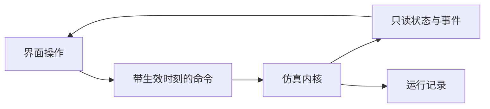

# 桌面界面设计

Movara 桌面提供交通场景的可视化、运行控制和信息检查。界面读取内核快照并提交命令，仿真状态与逻辑时间由内核维护。本文描述交互方案，交付范围见[路线图](../ROADMAP.md)。

## 应用与启动模式

桌面与命令行功能通过同一个应用交付。Windows 使用单个 `movara.exe`，默认启动 GUI，指定 `--headless` 后进入无界面模式。模式在启动时选择，共用同一份可执行文件。

正常启动直接打开 GUI，保持无额外控制台窗口的桌面体验。headless 模式通过命令行提供标准输出、错误和退出结果。

```text
movara.exe
movara.exe --headless <场景配置>
```

上述形式说明启动模式，场景、输出和运行控制的具体参数随命令行接口设计确定。

应用在初始化前解析启动参数。GUI 模式创建窗口、画布和交互循环，无界面模式直接运行场景与命令行任务。无界面模式跳过窗口、画布和 GUI 渲染初始化。

两种模式在进程内创建和调用内核，采用相同的场景、命令和执行语义。内核与 GUI 在代码层面分别组织。Python API 库可以连接已有应用，也可以启动其中一种模式，操作应用持有的仿真实例。

GUI 操作与 Python API 调用使用统一调度入口。两个入口共享运行与修改能力，控件依据仿真运行状态表达可用操作。命令按类型合并、覆盖或有序执行，规则见[执行与记录](execution.md)。实例连接要求见[Python API 设计](../python-api/README.md)。

Windows 的进程启动、终端连接、标准输入输出、重定向、退出码与中断行为作为入口集成的验收内容。具体控制台连接方式属于平台实现细节。

## 界面布局

| 区域 | 功能 |
| --- | --- |
| 运行控制 | 加载、运行、暂停、单步、重置，以及 Tick 和逻辑时间显示 |
| 场景画布 | 道路与主体显示、平移缩放、选择和轨迹图层 |
| 属性面板 | 查看主体状态、策略和参数，编辑允许修改的配置 |
| 信息视图 | 检查所选 Agent 的观测、消息、历史估计与未知区域 |
| 事件视图 | 查看接触、违规、接管、处置与恢复事件 |
| 配置与结果 | 保存场景、命令与运行记录，加载可重复的实验条件 |

初始原型提供运行控制、画布操作和主体属性检查。参数编辑、信息图层与事件操作按阶段加入。

## 运行与编辑

界面操作转换为具有明确生效 Tick 的内核命令。暂停编辑保持逻辑时间，提交成功后在指定边界应用。验证失败时显示具体对象、字段与原因。



界面刷新频率与仿真 Tick 分别控制。降低帧率、关闭图层、选择主体和切换视图均应保持逻辑结果一致。墙钟操作记录实际接受与生效 Tick，命令重跑使用记录中的逻辑时刻。

主体参数被后续命令覆盖时，界面可以显示最终值及其来源。无效修改显示具体错误，需要注意的有效操作附带警告。普通字段合并与覆盖保留在命令结果中。

同步控制回合等待 Python 提交时，GUI 保持显示、检查与请求接收。仿真运行状态应区分正常运行、人工暂停、等待提交和故障停止。控制失败时停止推进并显示原因，保留现场用于诊断。

完整命令、控制来源与恢复语义见[执行与记录](execution.md)。

## 二维与 2.5D 显示

二维视图用于道路关系、主体运动和空间事件检查。2.5D 视图通过二维绘制表达盒体、圆柱、简单高度和阴影，使用同一世界数据。

视图切换保持状态、动作和事件一致。显示插值用于画面连续性。接触事实来自内核运动与几何查询。

画布处理平移、缩放、拾取与坐标反变换。视角旋转作为后续扩展，需要同时处理深度排序、标签和对象选择。自由三维视角需要独立的渲染方案。

道路高程、立交接触和三维查询按几何能力分别验收。2.5D 外观不代表已具备这些能力。

## 世界视图与主体信息

世界视图展示内核状态，供场景检查和调试。主体信息视图展示选定 Agent 的实际可用输入，区分直接感知、通信获得、历史估计和未知区域。

历史对象显示信息年龄与来源，延迟消息保留观测和到达时间。信息图层应使读者能够检查遮挡、共享目标和记忆更新的效果。

GUI 俯视画面与模型 BEV 输入分别生成。模型输入遵循[核心信息边界](core.md#规划输入与显示)。

## 管理与实验操作

交通管理界面按监测、交通生成、信号、道路组织、信息发布和事故处置组织。实验操作提供主体接管、策略切换与条件对照。完整能力范围见[平台需求](../requirements.md#交通管理与场景干预)。

建议的初始操作流程为：加载地图与场景，运行交通，暂停检查主体，单步观察事件，保存配置与实际命令，再通过 CLI 或 Python 重跑。

交互式事故录制可以扩展为选择主体、临时接管、执行动作、释放控制和保存轨迹。完整时间轴编辑器与救援调度控制台另行安排。

仿真录制覆盖影响世界的 GUI 命令、Python 操作、命令解析、实际动作和事件。画布与面板操作可以单独记录为观看过程。录制、结果回放和实验分支使用[统一记录语义](execution.md#仿真录制)。

## 显示实现

桌面框架优先评估 GPUI Kit。普通面板与交通画布分别组织，对象绘制采用适当的批次和可见范围筛选。框架选型见[开发指南](../development.md#依赖选择)。

Windows 作为优先验收平台，Linux/macOS 的构建与交互支持分别验证。输入法、缩放、对象拾取和大量对象绘制属于桌面验收内容。

GUI 渲染设备与内核计算设备分别管理。共享设备或缓冲区需要明确的互操作支持，无界面内核保持独立的资源生命周期。

## 后续画面与传感器输出

外部表现后端消费 Movara 的对象状态，负责画面、动画和传感器输出。基本行为与规划直接使用结构化信息。

CARLA 作为后续可选后端，需要定义坐标、实体身份、内核 Tick、后端帧及传感器时间的映射。接触事实由 Movara 产生，后端事件保留自身来源。

表现可以采用插值和近似动画，显示精度按输出用途确定。车轮和步态效果需要单独适配。完整逐帧采集应记录采集与到达时间。

条件视频生成、重建与神经渲染可作为其他输出方向，NVIDIA Cosmos Transfer 和 NuRec 属于候选。所需资产、输入、运行成本和实时性在采用时验证。

外部物理控制、驾驶设备、远程访问和完整三维作为独立扩展设计。外部物理控制必须定义主体状态的唯一权威、同步方向和恢复规则。
