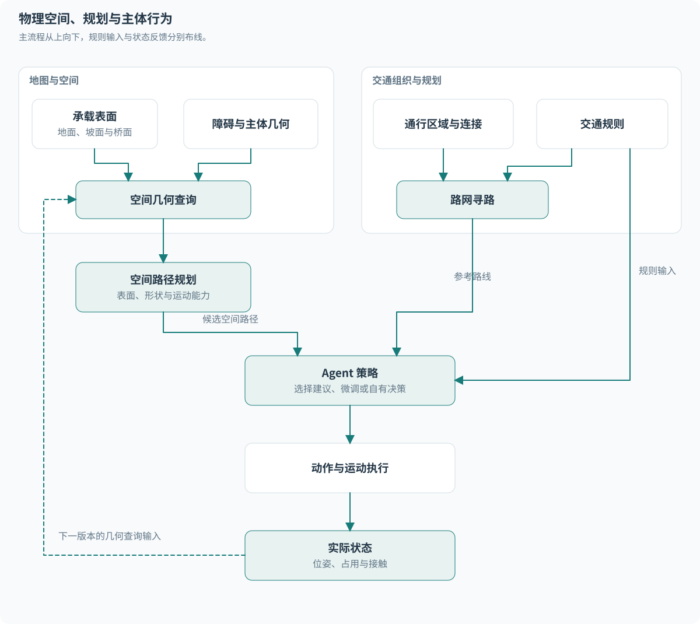
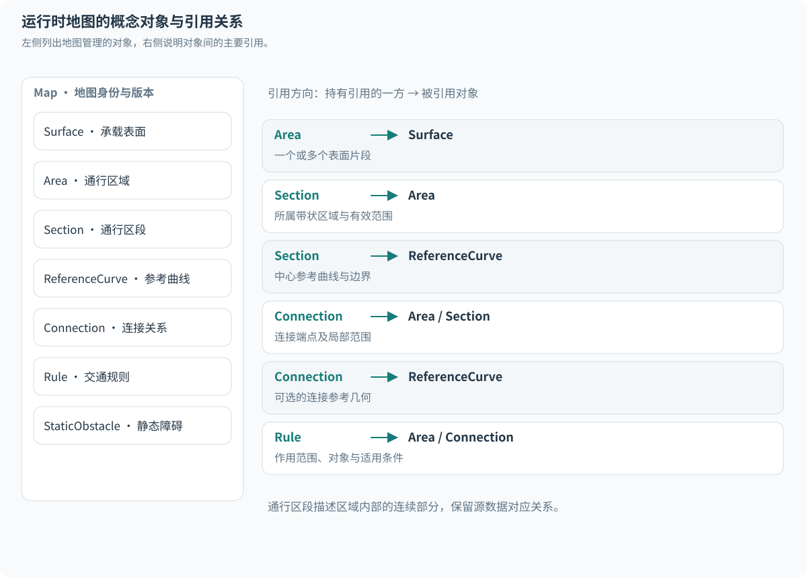
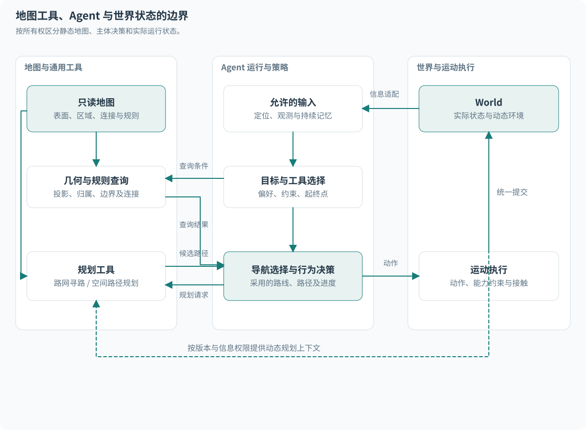
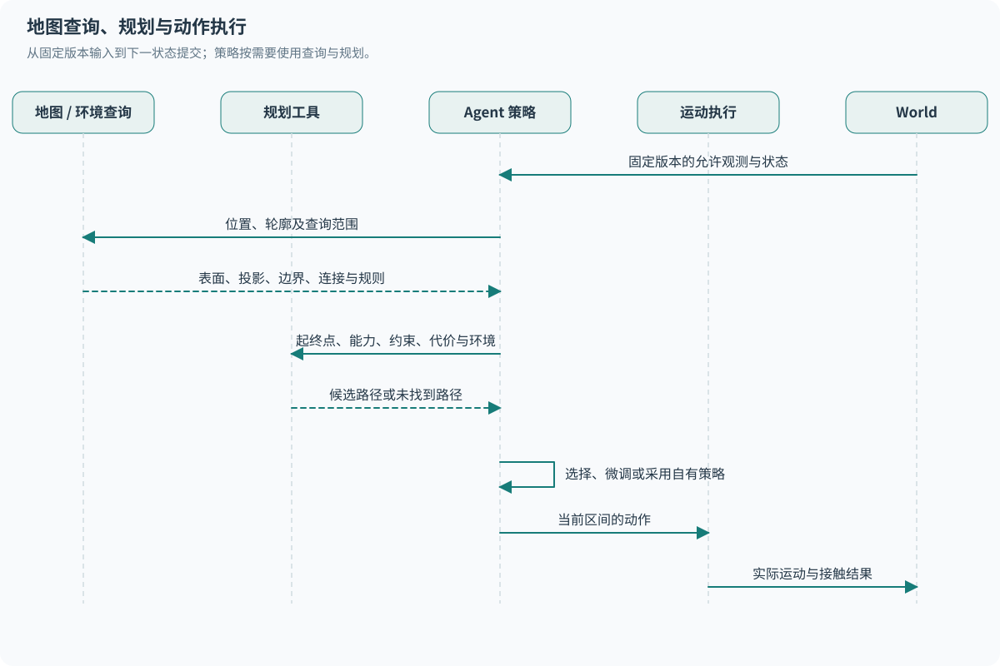
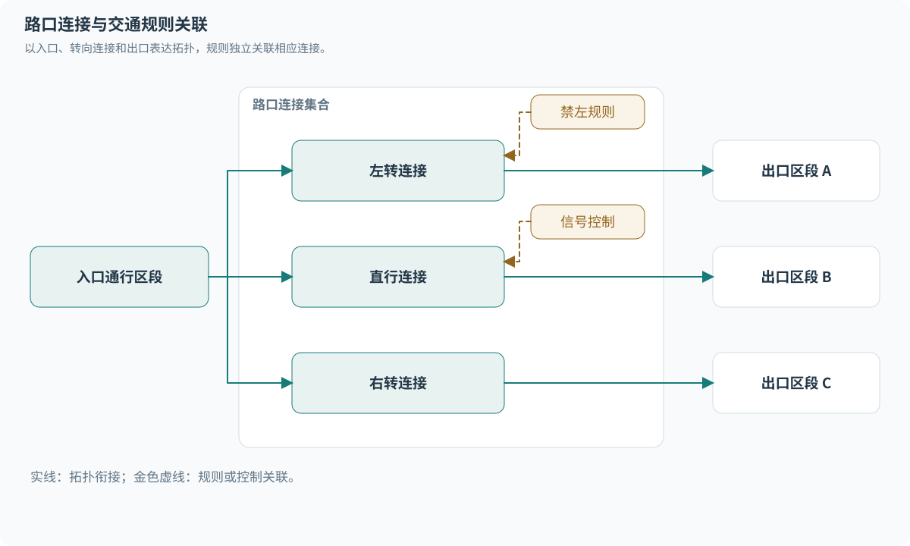
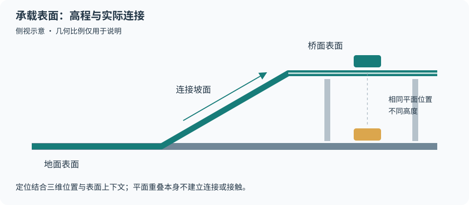
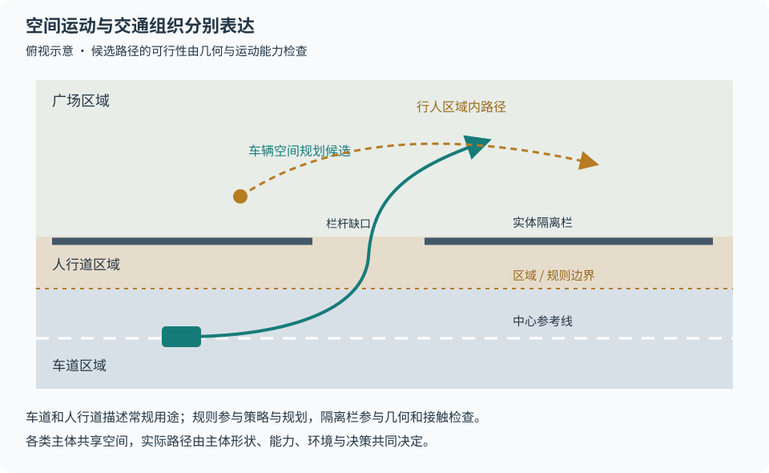

# 路网与空间模型

Movara 以承载表面、实体障碍和主体实际位姿描述物理空间，以通行区域、连接和交通规则描述交通组织。OpenDRIVE 是地图输入格式，运行时地图按本章定义的职责组织。

主体的数据与道路关系查询见[主体设计](agents/README.md)，运动执行与接触见[运动模型](agents/motion.md)。本文定义内部模型及接口语义，具体存储结构和算法按验证结果确定。

## 物理空间与交通组织

所有 Agent 在同一物理空间中运动。汽车、自行车和行人使用统一的空间表达，具体可达范围取决于各自的尺寸、形状、运动能力、地表条件和实体障碍。

车辆可以逆行、从出口匝道驶入、驶上人行道或离开道路。道路归属和规则状态根据实际位置计算。主体类别不构成将其限制在指定车道内的运动边界。



<details>
<summary>图示源码（Mermaid）</summary>

```text
flowchart TD
    SURFACE[承载表面：地面、坡面、桥面等] --> GEOMETRY[空间几何查询]
    OBSTACLE[实体障碍与主体几何] --> GEOMETRY
    NETWORK[通行区域与连接] --> ROUTE[路网寻路]
    RULE[交通规则] --> ROUTE
    RULE --> POLICY[Agent 策略]
    GEOMETRY --> SPACE[空间路径规划]
    ROUTE --> POLICY
    SPACE --> POLICY
    POLICY --> ACTION[动作与运动执行]
    ACTION --> STATE[实际位姿、占用与接触]
    STATE --> GEOMETRY
```

</details>

规划器生成建议，Agent 选择动作，引擎计算实际结果。Agent 可以采用规划结果、调整局部行为，也可以执行自有策略。规则遵循程度由策略及规划配置表达。

## 承载表面与三维表达

承载表面描述主体落脚或行驶的地表，包括路面、路肩、广场、草地等。地表属性用于描述与主体运动有关的条件，道路用途和交通规则另行关联。

桥梁、隧道和地面道路可以在平面投影上重叠。表面保留高程、空间层级和连接关系，定位与接触查询考虑相应高度。层级标识用于辅助筛选，实际几何用于确定空间关系。

Transform 表达三维位置与姿态；位置、线速度、加速度和角速度使用三维数据。Waypoint 同样提供三维位置与参考姿态。初始平面模型采用 Z=0，并使用绕 Z 轴的航向分量。接口的三维表达与运动模型支持的自由度分别声明。

道路投影提供纵向进度、横向偏移，以及按查询能力提供的高差等关系。道路参考线坐标、车道参考曲线平面弧长和世界三维距离分别保留各自含义，具体约定见[纵横向坐标与结果](agents/state.md#纵横向坐标与结果)。

地图覆盖范围和运动模型支持的表面能力需要明确声明。覆盖外位置与缺失的表面信息按相应能力返回结果或错误。未建模区域不自动解释为可通行地面。

## 运行时地图结构

| 组成 | 内容 | 用途 |
| --- | --- | --- |
| 承载表面 | 空间形状、高程、地表属性与表面连接 | 定位、地表关联及空间规划 |
| 实体障碍 | 隔离栏、墙体等实际几何 | 空间查询、规划候选检查和接触检测 |
| 通行区域 | 车道、人行道、过街区、等待区和共享空间 | 描述常规交通组织及局部活动区域 |
| 参考曲线 | 道路参考线、车道中心参考曲线等 | 坐标投影、局部参考与几何采样 |
| 连接关系 | 纵向衔接、横向相邻、区域出入口和路口连接 | 建立导航搜索所需的关系 |
| 交通规则 | 允许方向、主体类别、限速、标线、转向与信号关联 | 规则查询及规划条件 |
| 派生数据 | 空间索引、采样结果、搜索图与绘图数据 | 加速查询、规划与显示 |

地图对象使用地图版本内有效的稳定身份，源道路、车道段和车道标识另行保留以便追溯。静态地图数据与运行中的信号、临时障碍等世界状态通过明确引用关联，查询使用相应版本。

### 曲线方向与通行方向

参考曲线具有固定方向，用于定义纵向坐标、左右关系和参考姿态。交通规则表达允许的通行方向，包含正向、反向或双向等情况。主体实际速度与姿态保持独立。

逆行主体仍然可以获得有效的曲线投影、横向偏移与区域归属。规则判断通过独立查询表达。Waypoint 的参考姿态沿所选曲线方向定义，选定行驶方向后的导航参考需要明确自己的方向。

### 通行区段与路口连接

通行区段以连接关系和相关属性的一致性为划分依据。导入器根据明确的连接或属性变化拆分区段，保留与源数据的对应关系。内部区段与源文件中的区段可以具有不同粒度。

纵向衔接、横向相邻和允许换道的范围分别记录。几何相邻表示空间关系，换道规则表达通行条件。路口转向连接关联入口、出口、必要的参考几何、规则和信号。

拓扑用于描述导航工具已知的通行组织。主体的实际运动由空间几何与运动模型执行。连接图没有覆盖的路径，可以通过空间规划或 Agent 自有策略探索。

### 带状区域与自由区域

车道、人行道等适合采用带边界的连续带状结构，广场、等待区等适合采用具有边界的区域结构。区域和带状结构可以通过入口、出口或共享边界建立导航联系。

各类主体均可使用区域内的几何规划能力。车辆尺寸和转向能力会影响路径选择，行人与自行车也可以沿通行网络遵循常规路线。类别与规划工具的选择分别配置。

## 概念数据结构与关系

以下名称表示概念职责，具体 Rust 类型和存储布局在实现时确定。地图对象描述空间与交通组织，主体状态和导航选择具有独立的所有权。

### 地图对象关系



<details>
<summary>图示源码（Mermaid）</summary>

```text
flowchart TB
    MAP[Map：地图身份与版本]
    SURFACE[Surface：承载表面]
    AREA[Area：通行区域]
    SECTION[Section：带状通行区段]
    CURVE[ReferenceCurve：连续参考曲线]
    LINK[Connection：连接关系]
    RULE[Rule：交通规则]
    STATIC[StaticObstacle：静态障碍]
    MAP --> SURFACE
    MAP --> AREA
    MAP --> CURVE
    MAP --> LINK
    MAP --> RULE
    MAP --> STATIC
    AREA -->|关联一个或多个表面片段| SURFACE
    SECTION -->|带状区域的区段描述| AREA
    SECTION -->|中心参考与边界| CURVE
    LINK -->|起点、终点及适用范围| AREA
    LINK -->|可选连接几何| CURVE
    RULE -->|作用对象与空间范围| AREA
    RULE -->|作用连接与条件| LINK
```

</details>

图中的关联表示概念引用，具体实现可以采用类型化 ID。通行区段描述带状区域中的连续部分，自由区域可以直接参与连接。道路作为来源与组织信息关联这些对象，区域和表面保留独立身份。

| 概念对象 | 核心数据关系 | 关键约定 |
| --- | --- | --- |
| 地图 | 地图身份、版本及各类对象集合 | 同一地图版本内引用有效，派生数据关联来源版本 |
| 承载表面 | 三维几何、地表属性、表面邻接或连接 | 平面重叠的表面通过高程及实际连接区分 |
| 通行区域 | 空间边界、关联表面、交通用途 | 用途描述交通组织，主体实际占用通过几何查询计算 |
| 通行区段 | 所属区域、有效范围、参考曲线及边界引用 | 在连接或相关属性变化处划分，保留源数据对应关系 |
| 连接 | 两端区域或区段、连接类型、端点或范围、可选参考几何 | 纵向衔接、横向邻接、区域出入口分别表达 |
| 规则 | 作用对象或范围、适用条件、规则内容及动态状态引用 | 固定曲线方向与允许通行方向分别表达 |
| 静态障碍 | 空间几何、位置及来源 | 静态地图障碍与运行中实体通过不同所有者管理 |
| 查询与规划结果 | 地图版本、查询输入或规划条件、结果数据 | Waypoint、投影及路径由基础数据派生 |

连接端点需要表达所属对象及其局部位置或范围。换道关系可以覆盖一段纵向范围，区域出入口可以覆盖一段边界。路口连接可以携带转向参考几何。

引用有效性、连接端点范围和源身份对应关系在地图构建时检查。采样点、空间索引、搜索图和绘图缓存可从基础数据重建，重建规则与精度条件需要明确。

### 地图与 Agent 的接口边界



<details>
<summary>图示源码（Mermaid）</summary>

```text
flowchart LR
    subgraph MAPSIDE[地图与通用工具]
        MAPDATA[只读地图：表面、区域、连接、规则]
        QUERY[投影、归属、边界与连接查询]
        PLAN[路网寻路与空间路径规划]
        MAPDATA --> QUERY
        MAPDATA --> PLAN
    end
    subgraph AGENTSIDE[Agent 运行与策略]
        INPUT[允许获得的定位、观测和记忆]
        CHOICE[目标、偏好、约束与工具选择]
        NAV[采用的路线、局部路径及进度]
        DECISION[行为决策]
        INPUT --> CHOICE
        CHOICE --> NAV
        NAV --> DECISION
    end
    CHOICE -->|查询条件与规划请求| QUERY
    CHOICE -->|起终点、能力与代价| PLAN
    QUERY -->|几何关系与规则数据| NAV
    PLAN -->|候选路线或路径| NAV
    DECISION -->|动作| EXEC[运动执行与接触处理]
    WORLD[World：实际状态与动态环境] -->|按信息权限构造输入| INPUT
    WORLD -->|版本化的动态查询上下文| PLAN
    EXEC -->|统一提交| WORLD
```

</details>

地图维护空间事实、固定规则与连接，Agent 维护目标、导航选择、进度、行为偏好和决策记忆。规划器接收主体形状、运动能力及调用方提供的环境上下文，输出候选结果。规划器自身所需的临时搜索数据由工具管理。

Agent 的路线和目标通过运行接口设置，实际位姿由世界保存。地图查询保持只读；主体移动、路线切换和策略变化不修改静态地图。动态信号、临时障碍和交通状态来自相应版本的世界或允许的观测。

静态规则定义可以关联信号身份，当前灯色通过动态状态查询取得。信息适配负责向有限观测策略提供允许的数据，地图与规划接口沿用该信息范围。



<details>
<summary>图示源码（Mermaid）</summary>

```text
sequenceDiagram
    participant P as 规划工具
    participant Q as 地图与环境查询
    participant A as Agent 策略
    participant E as 运动执行
    participant W as World
    W->>A: 固定版本的允许观测与状态
    A->>Q: 位置、轮廓及查询范围
    Q-->>A: 表面、投影、边界、连接与规则
    A->>P: 起终点、能力、约束、代价及环境上下文
    P-->>A: 候选路径或未找到路径
    A->>A: 选择、微调或采用自有策略
    A->>E: 当前区间的动作
    E->>W: 提交实际运动与接触结果
```

</details>

该流程表示能力组合，具体策略按需调用查询与规划。已有路线可以跨多个 Tick 使用，重新规划时机由 Agent 决定。

## 典型空间与连接示意

本节用于说明模型表达能力，图中连线表示明确标注的关系。示意图不规定几何比例或具体搜索算法。

### 普通道路与路口



<details>
<summary>图示源码（Mermaid）</summary>

```text
flowchart LR
    IN[入口通行区段] --> LEFT[左转连接]
    IN --> STRAIGHT[直行连接]
    IN --> RIGHT[右转连接]
    LEFT --> OUT1[出口区段 A]
    STRAIGHT --> OUT2[出口区段 B]
    RIGHT --> OUT3[出口区段 C]
    RULE[禁左规则] -.->|关联| LEFT
    SIGNAL[信号控制关联] -.->|关联| STRAIGHT
```

</details>

左转连接保留其空间与拓扑描述，禁左规则通过关联表达。要求遵守禁左的规划请求会排除相应候选；允许将违规作为代价的请求按自身配置搜索。实际转向由主体动作和运动能力决定。

### 立交与表面连接



<details>
<summary>图示源码（Mermaid）</summary>

```text
flowchart LR
    G1[地面表面 A] -->|连续表面| G2[地面表面 B]
    G2 -->|匝道连接| R[坡面]
    R -->|连续表面| B1[桥面 A]
    B1 -->|连续表面| B2[桥面 B]
    G1 -.->|平面投影重叠，连接另行判断| B1
```

</details>

地面与桥面可以具有相同的平面坐标，定位仍需依据高度与表面上下文选择候选。主体通过实际存在的坡面或其他连接进入上层表面。平面投影重叠不建立通行连接，也不单独构成接触事实。

### 车辆离开常规路线与区域内自由运动



<details>
<summary>图示源码（Mermaid）</summary>

```text
flowchart TB
    subgraph SPACE[共同的物理空间]
        ROAD[道路表面与车道区域]
        EDGE[地表过渡带]
        WALK[人行道区域]
        PLAZA[广场区域]
        ROAD ---|表面连接与过渡几何| EDGE
        EDGE --- WALK
        WALK --- PLAZA
    end
    CAR[车辆策略] -->|可请求空间规划| WALK
    PERSON[行人策略] -->|可请求区域内路径| PLAZA
    NETWORK[常规通行网络] -.->|提供参考走廊| ROAD
    NETWORK -.->|提供参考走廊| WALK
    WALL[墙体或隔离栏] -.->|参与局部几何检查| EDGE
```

</details>

车辆驶上人行道的候选路径需要检查实际过渡几何、车辆尺寸与运动能力，规则条件由规划请求提供。隔离栏参与障碍检查，禁行规则参与规则判断。

行人穿越广场时，可以直接利用区域几何规划局部路径。车辆和非机动车同样可以使用这类工具。各主体实际可执行的路径仍受自身能力与环境几何影响。

## 规划工具与 Agent 决策

### 路网寻路与空间路径规划

| 工具 | 依据 | 主要结果 |
| --- | --- | --- |
| 路网寻路 | 通行区段、区域连接、规则、约束与代价 | 道路、区段或通行走廊序列 |
| 空间路径规划 | 承载表面、障碍几何、主体形状与运动能力 | 空间中的候选路径 |

两类工具可以组合使用。长距离导航先选择通行走廊，局部规划再决定具体路径与横向位置。Agent 根据观测和目标选择采用哪种工具，必要时调整路线或局部计划。

路径描述空间经过关系，带时间的轨迹描述未来运动计划。路径跟踪与轨迹执行进一步生成运动输入，实际状态由运动模型产生。

非机动车可以在可用区域内选择横向位置、避让和穿越路径，车辆同样保留这种能力。参考策略可以采用中心线跟踪，其他策略可以使用区域代价或自有规划。

### 约束、代价与偏好

规划调用方提供起终点、主体能力、所需约束和代价配置。规划器在这些条件下搜索候选路径。

| 因素 | 规划中的用途 |
| --- | --- |
| 主体尺寸、运动能力、地表与实体障碍 | 检查所选规划模型中的几何及运动可行性 |
| 通行方向、禁转等规则 | 按配置作为必须满足的条件或违规代价 |
| 距离、时间、舒适性和风险 | 比较候选路径 |
| 行为偏好 | 调整代价、目标位置或候选选择 |

正常交通策略可以要求规划结果满足相应规则，研究策略可以调整规则约束和违规代价。各类主体的默认偏好由具体策略定义。平台不按主体类别统一规定规则遵循程度。

偏好可以先用确定性的参数表达。采用随机选择时，随机状态遵循运行种子与主体状态的保存规则。

### 查询与结果边界

地图提供表面、障碍、连接、规则、投影和几何关系查询。Agent 根据允许获得的信息组合这些能力，判断局部行动。有限观测策略沿用[信息边界](core.md#agent-信息与记忆)。

实体障碍描述物理阻挡，禁左等规则描述交通限制。运动执行检查运动学有效性并处理实际接触。规则违规通过相应查询或事件表达。

寻路接口区分找到路径和未找到路径。输入无效、对象失效或所需能力未受支持按错误处理。未找到路径表示本次规划条件下没有获得结果，结果关联所用地图、约束和搜索范围。该结果不证明物理不可达。

平台不要求地图提供覆盖所有主体与情境的统一“可通行”结论。轮廓容纳、障碍距离和接触等具体查询可以独立提供，供规划器与 Agent 复用。

## Waypoint 与局部参考接口

Waypoint 是参考曲线上某个位置的只读查询对象，提供三维位置、参考姿态、曲线身份和纵向坐标，并按能力提供区段、宽度、边界及连接信息。对象保留地图版本和明确的曲线方向。

Agent 可以使用 Waypoint 构造局部目标、调整参考位置或查询后续连接。横向偏移、航向差等关系由直接投影查询提供。按距离采样曲线属于便利功能，采样密度按调用需求选择。

运行时地图以连续几何、区域和连接维护基础结构。Waypoint 由这些数据查询生成，内部索引和缓存可以复用采样结果。主体实际位置保持独立，查询过程遵循只读语义。

## 导入、补充与数据来源

OpenDRIVE 导入器将受支持的源几何、属性与连接转换为运行时模型，建立源身份与内部身份的对应关系。源格式支持范围和缺失能力按[地图导入验收](../development.md#地图导入验收)说明。

外部工具也可以通过地图构建接口批量提交几何、通行区域、连接、规则和来源信息，经统一校验后形成地图版本。事故重建工具可以使用这一路径提交局部地图。文件导入器与程序化构建复用地图装载和校验边界，具体接口随相应阶段设计。

地图采用本地公制坐标，地理参考作为可选元数据保留。接入卫星底图时声明地理坐标、投影或局部配准到地图坐标的映射，影像身份与配准信息随场景保存。后续用途见[地图与场景扩展](../requirements.md#后续地图与场景扩展)。

通行区段首先依据明确的连接与属性建立。学校区域、特殊活动区等高层语义通过相应输入或场景补充表达。承载表面和区域覆盖范围也可以由场景补充，并记录其来源。

自动推断可作为导入辅助，结果保留推断依据和可修订的数据。关键连接缺失或存在歧义时，地图检查需要明确报告。未经确认的推断不作为确定的连接事实。

Rust 中由 `Map` 组织只读地图与派生索引，`World` 保存主体和动态环境状态。Python 与 GUI 复用相同领域语义，公开地图对象及规划结果携带对应身份和版本。具体 Rust 类型、Python 方法签名及规划算法在实现设计中细化。
