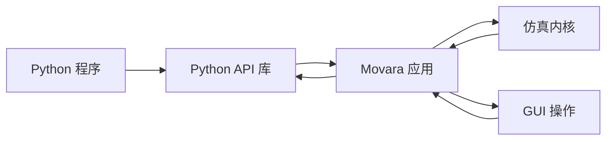

# Python API

Movara Python API 库为 Python 程序提供应用连接、场景操作、运行控制与数据访问，导入名为 `movara`，代码位于 `crates/movara-python`。

本组文档定义 API 的基本对象、关键接口和使用约定。接口签名与示例用于设计评审，具体类型和参数随接口细化。

## 文档导航

| 文档 | 内容 |
| --- | --- |
| [API 运行模型](runtime.md) | 统一推进、事件循环、运行时序泳道图与多客户端交互 |
| [连接与会话](session.md) | 连接、启动、自动订阅与生命周期 |
| [数据与控制](data-and-control.md) | 数据对象、查询、控制回合、批量提交和事件 |
| [事件与回调](events.md) | Python 回调、实时控制、定时命令及事故处理 |
| [本机通信](transport.md) | TCP 长连接、消息编码、多实例与启动就绪 |
| [使用示例](examples.md) | 同步控制、动态查询与观察流程 |

内核与应用的职责见[核心设计](../design/core.md)，命令解析、故障停止与录制规则见[执行与记录](../design/execution.md)。

## API 与应用

应用在进程内持有仿真实例，内核负责世界状态和逻辑时间。Python API 库通过应用接口访问该实例，GUI 展示相应的状态与事件。

API 的公开语义与内部传输实现分别设计，原生扩展、序列化和数据缓冲按实际需求选择。

Python API 封装统一 Rust 领域接口，通过应用访问同一仿真实例。GUI 的仿真操作使用相同接口与协调入口，界面状态和绘图在 GUI 中维护。领域规则由内核集中实现，跨入口的语义保持一致。

Python API 可以维护连接、本地回调、结果缓存与便捷操作所需状态。Agent 记忆、内置行为状态和仿真命令由运行上下文持有，详细划分见[API 与仿真状态](../design/core.md#api-与仿真状态)。

多个 Session 可以连接同一应用并共享同一仿真。各连接维护自己的订阅和本地状态，主体行为切换与恢复计划保存在内核。早期以单机使用为主，多客户端的策略分工及后续跨机器接入见[多客户端与运行范围](../design/core.md#多客户端与运行范围)。

## 关键约定

1. `connect` 和 `launch` 返回相同的 `Session`，并在返回前完成相应模式的订阅建立。
2. 默认建立逐 Tick 控制订阅，应用在约定边界等待 Python 批量提交。`control=False` 初始仅登记观察订阅，后续可以独立登记事件控制回调。
3. `session.frames()` 消费已建立的控制订阅，读取帧时沿用已有连接和订阅。
4. `frame.data` 是随回合批量收到的本地数据。读取属性和遍历记录保持本地访问。
5. `frame.query(...)` 明确发起动态查询，返回本回合固定状态版本的数据。
6. `frame.submit(...)` 一次提交动作和命令。无新增干预时显式提交空批次。
7. GUI 与 Python 共享操作能力，合并、覆盖和生效顺序由统一命令规则决定。
8. 未完成控制回合的异常、断线或超时导致该次仿真报错停止，并保留诊断现场。
9. `close()` 断开连接，`shutdown()` 明确请求应用退出。未完成回合的提交义务保持有效。
10. 同步与异步形式共享相同语义，初始接口先提供同步写法。
11. 定时命令和固定内置行为在 Rust 中执行，Python 回调在调用方进程执行。逐 Tick 控制和事件控制可以独立使用，也可以按阶段组合。

控制订阅的建立与逻辑步推进分别处理。新应用在场景就绪和收到运行请求后推进；连接正在运行的实例时，控制订阅从确认的边界生效。

主体查询返回完整基础状态包装对象，提供中心原点的 Transform、尺寸、轮廓与运动信息。预定义查询和动态查询用于选择对象集合或相应专题，基础属性在本地读取。

## 文档与代码说明

本组文档维护使用流程、跨接口约定、数据一致性和关键示例。方法签名、参数、返回值、异常和局部示例在实现中以类型标注及 docstring 为主要说明来源。

参考文档可以由代码签名、类型与 docstring 自动生成。设计页与生成的接口参考共同组织阅读入口，避免长期手工重复完整的逐函数说明。文档生成工具在构建流程中选择，本组设计不要求先建立文档站点。
