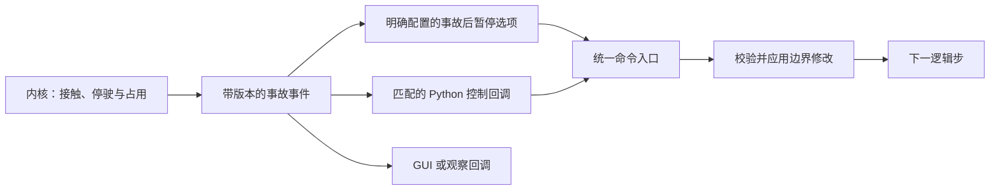

# 事件与回调

Movara 通过领域事件描述仿真事实，提供 Python 事件回调和逐 Tick 实时控制。已知时刻的操作通过定时命令提交，固定内置行为通过明确的场景选项配置。

## 调用方式

| 方式 | 执行位置 | 触发与通信 | 用途 |
| --- | --- | --- | --- |
| Python 事件回调 | Python 进程 | 登记过滤条件，匹配事件后交付上下文与批量结果 | 自定义判断、外部算法、复杂事故处置 |
| 逐 Tick 实时控制 | Python 控制循环 | 按订阅接收固定版本数据并提交动作 | 持续策略计算、实验干预和逐步决策 |
| 定时命令 | Rust 内核 | 提前提交命令和目标 Tick，由命令队列按时处理 | 已知时刻的信号、场景或主体干预 |
| 内置选项 | Rust 内核 | 根据明确的场景配置执行已经实现的行为 | 事故后暂停等固定能力 |

定时命令复用普通命令及其生效时刻，内置选项由普通 Rust 代码实现。配置保存沿用场景数据格式。通用任务描述语言、条件表达式解释器和可编程规则系统不属于该设计。

回调的执行位置由接口明确指定。平台不分析、转换或编译用户的 Python 函数。

任意 Python 函数在 Python 进程执行。向内核登记的是事件过滤与交付要求，函数本身由 Python API 的回调调度器保存。事件通知可以按批次传输，仅事件匹配时产生相应交付。

事件过滤只包含事件类型、对象等结构化参数，应用按这些字段选择需要通知的事件。Python 回调的执行位置保持固定，调用方只需选择事件和处理函数。

回调表达事件驱动的调用方式。同步与异步表达 Python 如何等待和调度，两者分别定义。首轮同步接口可以执行普通函数回调，后续异步接口沿用相同的事件、版本和控制规则。

回调与普通循环是组织代码的两种方式。调用方可以遍历事件并判断，也可以登记匹配的处理器，两者复用统一的逻辑步与命令提交机制。

## 事件数据

`Event` 至少包含运行身份、事件身份、类型、参与对象、所属 Tick、可取得的区间发生时刻和相关状态版本。接触事件保留接触过程身份，事故停驶、实体清除与运行故障分别使用自己的事件类型。

`frame.events` 和 `snapshot.events` 返回随本次交付收到的事件集合，读取和筛选发生在本地。过滤可以按事件类型、对象、类别或支持的区域条件表达。事件集合表示已交付的事实，当前仍有效的事故占用通过状态查询取得。

接触开始、事故停驶和事故清除分别表达。处理“发生事故”可以匹配事故停驶事件；处理具体几何接触可以匹配接触事件。连续接触沿用原过程身份，重复采样保持该事实的身份稳定。

连接确认包含事件订阅的生效边界。新订阅接收该边界起符合条件的事件；已有事故状态通过初始查询取得。重置和加载建立新运行后，事件身份按新的运行上下文校验。

### 生命周期通知

暂停、恢复、重置、运行结束、失败和应用退出作为生命周期通知交付，包含来源、原因及确认的运行状态。GUI 和 Python 客户端均可订阅，通知交付独立于仿真 Tick。

生命周期处理器采用观察模式。暂停与退出保持明确的完成条件，通知处理不参与推进等待。需要在下一逻辑步前完成干预的仿真事件使用控制回调。

应用确认终止或退出时，未完成回合收到明确的取消结果，等待中的客户端据此结束相应调用。详细边界见[生命周期通知](../design/execution.md#生命周期通知)。

## 回调注册与取消

Python 回调登记事件类型、对象等过滤条件与本地函数，返回 `Registration`，支持修改、取消和生效确认。注册同时声明控制或观察模式、所需查询与超时。具体方法名与参数类型在会话接口中确定。

过滤接口只接受定义清楚的字段。复杂条件判断放在 Python 函数中。回调结果关联事件及回调注册身份，命令继续保留接收顺序与执行结果。

注册接口校验过滤字段和模式。内核不执行任意 Python 函数。跨进程调用与批量传输由应用接口负责。

首轮事件过滤使用明确的类型与参与对象条件，复用通用查询中的类别和区域描述。复杂判断由本地函数执行。多个本地处理器按登记顺序处理匹配事件，事件顺序沿用应用交付顺序，返回的操作统一组成该次提交。

修改与取消以确认的注册版本和事件批次生效。已经选入当前回合的处理器完成本次调用，后续批次使用新注册状态。API 保留当前调用所需的函数与上下文，取消不会撤销已经发生的操作。

## 控制回调与观察回调

| 模式 | 推进关系 | 回调内容与失败 |
| --- | --- | --- |
| 控制回调 | 匹配事件时等待有效提交，完成后继续 | 可查询固定版本并返回命令；异常、断线或超时使该次运行失败 |
| 观察回调 | 通知后继续推进 | 用于日志、显示与外部分析，错误明确报告给调用方 |

控制回调取得 `EventContext`，其中包含事件批次、固定版本的查询结果和动态查询入口。回调返回一批操作，空结果表示本次没有干预。多个处理器的结果由驱动器收集后统一提交，保持对应事件控制回合的单次完成语义。

观察回调收到带版本的数据，之后提交的干预按当时的可用边界处理。需要在下一个逻辑步前完成的事件干预使用控制模式。

事件控制订阅可以单独使用，只在匹配事件时阻塞推进。它也可以与逐 Tick 控制并存，先完成边界事件处理，再准备新的逐 Tick 控制回合。`connect/launch(control=False)` 关闭初始的逐 Tick 控制等待，后续可以登记独立的事件控制回调。默认 `control=True` 建立的逐 Tick 订阅保持其提交义务。

Python 回调通过明确的会话驱动流程执行，回调模式和手写帧循环使用共同的消息处理能力。同一连接由一个驱动入口消费消息，具体流程见[API 运行模型](runtime.md)。

暂停期间继续交付事件事实与生命周期通知，查询和注册修改保持可用。需要影响后续运动的事件控制安排在再次推进前完成；应用开始该次控制回合时才启动提交等待期限。事件保留产生时刻与版本，待处理控制上下文明确其可查询的当前边界版本。

事件处理请求暂停时，回合确认后停止后续调度。重新开始运行时，先完成尚待处理的边界控制，再准备逻辑步。终止、重置和退出按生命周期规则取消相应的旧运行义务。

以下示例表达独立事件控制的使用方向，方法名和过滤类型随接口细化。事件驱动入口在运行期间分发回调，运行暂停后返回；回调异常按控制失败规则处理。

```python
from movara import Command, Event, EventContext, EventFilter, launch


def pause_after_incident(event: Event, context: EventContext) -> list[Command]:
    return [Command.pause()]


def run_until_incident(scene_path: str) -> None:
    with launch(control=False) as sim:
        sim.load_scene(scene_path)
        sim.on_event(
            EventFilter.types('incident_stopped'),
            pause_after_incident,
            control=True,
        )
        sim.run()
        sim.dispatch()
```

本例只有事件回调构成控制等待条件。正常 Tick 可以在应用内连续推进，事故发生后才交付控制回调。需要持续计算动作时，可以使用逐 Tick 控制循环并在 `frame.events` 中读取相同领域事件。

## 事故处理与信号调度

首次接触的停驶和空间占用由内核事故模型维护，接触后的事实随后进入事件批次。外部处理基于已提交状态生成干预，具体停止规则见[运动模型](../design/motion.md#接触与事故占用)。

收到事故事件后，回调可以提交暂停、路线变更、主体清除、信号方案调整和支持的处置任务。这些操作使用普通领域命令，各自检查对象、状态和生效条件。

信号调度需要遵循信号系统的状态转换与时间规则，具体相位及方案接口在交通组织设计中确定。回调本身保持统一的能力边界，相关命令的效果由内核执行并返回结果。



场景中的事故后暂停采用固定内置选项。其他事故后的交通管理策略通过 Python 回调和普通命令组织，各调用入口共用相同领域操作。

## 记录与重跑

运行记录保存内置选项、定时命令、事件过滤、注册与取消边界、实际触发事件、回调执行上下文版本、提交的命令及结果。外部回调的实际操作可以用于动作重放，重新执行 Python 算法需要相应代码与运行条件。

边界顺序与派生事件处理见[执行与记录](../design/execution.md#边界事件处理)。回调进入记录时保留其来源与触发依据，重跑使用已经确认的生效顺序。
