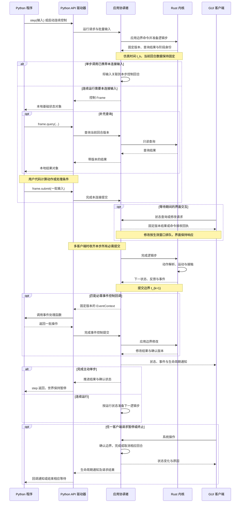

# API 运行模型

本文定义单步、连续运行、事件回调与多客户端交互的统一模型。连接入口见[连接与会话](session.md)，事件类型见[事件与回调](events.md)。

## 完整运行流程

本节定义统一的会话推进流程，以及调用方式、事件边界和生命周期之间的关系。方法与通信设计按相同语义细化。

| 阶段 | 调用方操作 | 应用职责 |
| --- | --- | --- |
| 连接与准备 | 连接或启动实例，登记查询与回调，加载场景 | 确认实例、运行、订阅与生效边界 |
| 组织调用 | 单次推进、持续循环，或登记事件处理器 | 沿用同一逻辑步机制，记录各连接的提交义务 |
| 读取与干预 | 读取本地状态对象，必要时补充查询，批量产生操作 | 提供固定版本查询，按来源与窗口解析操作 |
| 完成逻辑步 | 提交当前输入，或等待所需回调结果 | 推进运动与接触，提交状态并形成事件 |
| 处理事件 | 执行匹配回调，返回一批命令 | 完成边界处理后准备下一逻辑步 |
| 暂停与退出 | 暂停、正常断开、重置或退出应用 | 确认最终边界与未完成义务，保持故障处理规则明确 |

### 统一推进与调用组织

主动单步适合实验循环：调用方读取状态、计算动作，通过 `step` 一次提交一批输入并请求推进一个 Tick。返回结果包含推进后的快照、事件、命令结果与运动反馈。调用完成后保持暂停，多步循环逐次产生相应输入。

连续控制使用 `run` 与帧循环，应用按 Tick 发送固定版本数据并等待提交。它与主动单步共享同一套输入提交、逻辑推进和结果交付机制，区别在于是否由应用继续调度后续逻辑步。

`step` 自身作为该连接本次逻辑步的显式控制提交。应用保留其默认控制订阅，将随调用收到的输入关联到本步回合，其他控制客户端继续按各自订阅提交。单步调用同时完成本连接的输入提交与推进请求。

事件回调是统一流程上的调用组织能力，处理器在匹配时执行并返回操作。调用方可以在普通循环中读取事件，也可以登记处理函数；两种形式共用事件、查询和命令语义。事件处理与逐 Tick 决策可以组合，内核沿用同一执行阶段。

同一连接在一个时刻由一种驱动入口消费消息：主动单步、手写帧循环或回调驱动。切换入口发生在暂停且本连接既有回合完成后，控制订阅与注册可以保留。已持有待提交 Frame 时，主动单步返回调用状态错误。

`step` 等待期间，API 驱动器继续处理本连接已有的事件回调，并等待其提交确认后返回。回调通过自己的上下文查询及返回命令处理事件。回调中的递归单步、重置或启动另一个消息驱动入口返回调用状态错误，暂停等请求通过回调结果提交。

多个客户端共享世界推进权，系统命令仍按序执行。一个客户端请求暂停会影响整个实例，其他控制客户端的必需提交继续构成推进条件。需要隔离的并行实验分别创建应用实例。

### 暂停、失败与收尾

人工暂停停止后续自动推进，已经建立的控制回合先完成其提交义务。逻辑步完成后，匹配的事件控制在同一边界处理，执行暂停请求后停止准备后续逻辑步。

普通输入或调用状态错误返回相应操作结果。必需控制回合的异常、断线或超时触发该次仿真失败，保留最后状态和诊断。恢复通过重置或加载建立新运行。

正常关闭连接先完成当前回合，再确认注销本连接的控制订阅，其他客户端和应用保留。终止当前运行与退出整个应用分别处理，`shutdown` 明确作用于整个应用。

应用向客户端发送暂停、恢复、重置、运行结束、运行失败和应用退出等生命周期通知。通知保留来源、原因、运行身份、状态版本及相关请求，客户端可以通过状态查询、通知或观察回调处理。通知交付独立于新的仿真 Tick。

生命周期通知保持非阻塞交付。终止或退出显式取消尚未完成的回合，并返回对应原因。Python 等待逻辑据此结束，GUI 更新状态及诊断。具体状态事件与顺序见[生命周期通知](../design/execution.md#生命周期通知)。

首轮以本机连接、批量控制消息和基础状态对象交付为主，采用[本机通信](transport.md)定义的 TCP 长连接、长度前缀与 MessagePack 编码。GUI 沿用进程内 Rust 接口。共享内存、远程计算调度与复杂传输优化属于后续验证范围。

## 调度与时间

应用协调者通过主事件循环接收请求、管理控制回合并调度内核阶段。运行状态、命令顺序与最终提交由该协调入口维护。消息接收、界面绘制和计算可以采用各自适合的线程或任务组织方式。

仿真时间只随已完成逻辑步前进，墙钟时间用于消息等待、连接超时和界面刷新。等待 Python 提交时，当前回合的世界版本保持固定，GUI 查询与消息处理继续进行。

API 在当前驱动入口中分发请求结果、Frame、事件和生命周期通知。普通状态查询按自己的请求身份返回，当前回合的动态查询同时关联相应版本。驱动器保持回合身份与提交义务，用户代码可以采用普通函数或后续异步形式。

## 运行时序泳道图

图中 GUI 是进程内客户端，Python 经 API 与应用通信。箭头表示逻辑调用与消息关系，具体线程和传输方式由实现确定。图示一个逻辑步，连续运行重复使用同一流程。

单步入口已经携带的输入用于履行本连接的当步义务。其他控制方仍按自己的回合提交。事件控制处理后，边界修改先完成，应用再决定返回结果或调度下一逻辑步。

生命周期通知独立于仿真推进，暂停和运行结束时继续交付。实际事件可以在本 Tick 内产生，通知中的确认边界与事件实际发生时刻分别表达。
